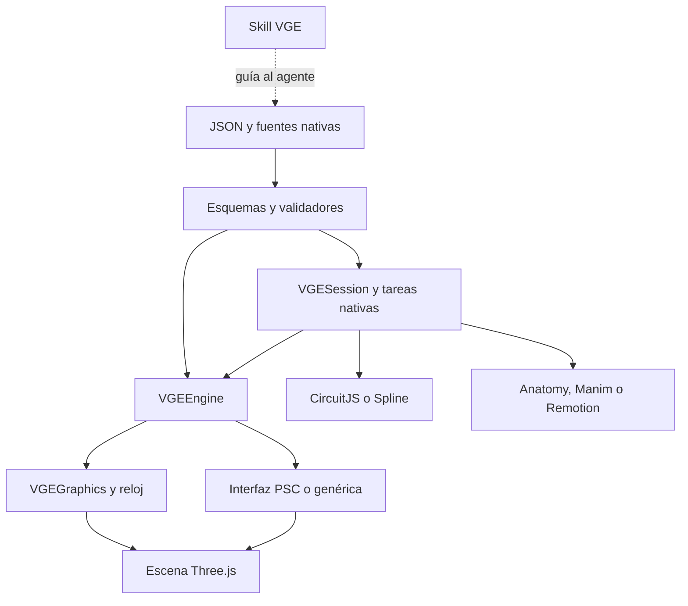

# AUDITORÍA DEL PROYECTO VGE

Fecha: 2026-10-22 13:11:58 EST (America/Panama). Proyecto `vge-v2-phase2@2.0.0-alpha.2.1`, archivo VGE-GitHub.zip versión 2. SHA-256: `95ebaf84fc051cf7ba2c7312ce0c2d72e26e7774a23f07fb91d7e526b5a38ff2`. Tamaño ZIP: 4062069 bytes; fuentes: 109 archivos, 6926274 bytes.

Se auditó una instantánea extraída del ZIP actual, no una reconstrucción de mensajes anteriores. La skill instalada se leyó desde `/root/.codex/skills/remote-skills/skill-6ad8ccde00048191b2ec865528e6866f`. La mejora del protocolo solicitada expresamente por el usuario se guardó antes de fijar la línea base, commit `4578a07`; desde esa línea base no se modificaron ni las 109 fuentes del proyecto ni los 9 archivos de la skill instalada. Todos los comandos que escriben se ejecutaron en una copia aislada.

La copia embebida de VGE corresponde al núcleo anterior al atajo de auditoría: difiere `SKILL.md` y falta `references/auditoria-del-proyecto.md`. Esto es una diferencia de distribución comprobada, no una avería del renderer. La carga de la versión de la skill en otras conversaciones es **NO VERIFICADO**.

**Dictamen:** listo con condiciones como instantánea de fuentes y demo PSC; **no listo como producto que ya ejecuta de extremo a extremo los cinco motores especializados**. Hay un defecto reproducido que borra una exportación anterior al fallar el siguiente render. Los tres motores pendientes, las limitaciones de capas y las de portabilidad se detallan abajo. Subir archivos, desplegar Pages y completar una integración son estados distintos.

Evidencia: E-lectura = fuente leída; E-comando = ejecución nueva registrada; E-probe = reproducción externa al proyecto; E-browser = Chromium con render. Un doble de prueba no es el motor nativo. **NO VERIFICADO** identifica cualquier capacidad no comprobada. No se aplicaron fixes ni se creó un repositorio remoto.

## 1. INVENTARIO

Las fechas siguientes son las registradas en el ZIP de entrada, que no almacena zona horaria: **zona NO VERIFICADO**. No se presentan las fechas de extracción como fechas de creación. La atribución de fase indica afinidad funcional; la fase exacta de creación de cada fuente es **NO VERIFICADO** sin un historial completo de esos archivos. La copia no contiene node_modules, entornos Python ni las salidas out de la entrega anterior. Estos se distinguen de las fuentes.

```text
VGE-GitHub/
  .gitignore  [71 B; 2026-10-23T01:52:32]
  AUDITORIA.md  [74350 B; 2026-10-23T01:51:04]
  README.md  [6424 B; 2026-10-23T02:04:12]
  demo/
    index.html  [9907 B; 2026-10-23T01:51:04]
    main.mjs  [1156 B; 2026-10-23T01:51:04]
  dist/
    THIRD-PARTY-LICENSES.txt  [6196 B; 2026-10-23T01:56:42]
    index.html  [989560 B; 2026-10-23T01:56:42]
  docs/
    CORRECCION-ADELANTO.md  [3792 B; 2026-10-23T01:51:04]
    FASE-1-CONTRATO.md  [10083 B; 2026-10-23T01:51:04]
    FASE-1-VERIFICACION.md  [2756 B; 2026-10-23T01:51:04]
    FASE-2.md  [6621 B; 2026-10-23T01:51:04]
    NUCLEO-HERRAMIENTAS.md  [9812 B; 2026-10-23T02:01:54]
    NUCLEO-VERIFICACION.md  [5733 B; 2026-10-23T02:04:12]
    REVISION.html  [2150521 B; 2026-10-23T01:51:04]
    index.html  [989560 B; 2026-10-23T01:51:04]
  engine/
    AssetLoader.mjs  [545 B; 2026-10-23T01:51:04]
    VGEEngine.mjs  [22916 B; 2026-10-23T01:51:04]
    factories.mjs  [3853 B; 2026-10-23T01:51:04]
    graphics/
      CoilPulse.mjs  [1379 B; 2026-10-23T01:51:04]
      FieldVectors.mjs  [6687 B; 2026-10-23T01:51:04]
      VGEGraphics.mjs  [8545 B; 2026-10-23T01:51:04]
      validateGraphics.mjs  [4515 B; 2026-10-23T01:51:04]
    ui/
      SignalDiagram.mjs  [1840 B; 2026-10-23T01:51:04]
      mountBeginnerVGE.mjs  [22652 B; 2026-10-23T01:51:04]
      mountVGE.mjs  [15357 B; 2026-10-23T01:51:04]
      status.mjs  [1203 B; 2026-10-23T01:51:04]
    validate.mjs  [9667 B; 2026-10-23T01:51:04]
  examples/
    bubble-sort.json  [12539 B; 2026-10-23T01:51:04]
    headless.mjs  [672 B; 2026-10-23T01:51:04]
    psc-factories.mjs  [2755 B; 2026-10-23T01:51:04]
    psc.beginner.graphics.json  [1517 B; 2026-10-23T01:51:04]
    psc.beginner.json  [69148 B; 2026-10-23T01:51:04]
    psc.graphics.json  [1037 B; 2026-10-23T01:51:04]
    psc.json  [69764 B; 2026-10-23T01:51:04]
    psc.lesson.json  [7399 B; 2026-10-23T01:51:04]
    unified/
      project.json  [4024 B; 2026-10-23T02:00:12]
      resistor.txt  [137 B; 2026-10-23T01:52:32]
  integrations/
    anatomy/
      build.mjs  [4093 B; 2026-10-23T01:59:42]
      vendor/
        LICENSE  [1062 B; 2026-10-22T02:09:32]
        SKILL.md  [33590 B; 2026-10-22T02:09:30]
        kit/
          audit.mjs  [92619 B; 2026-10-22T02:14:40]
          iso-kit.mjs  [35176 B; 2026-10-22T02:09:32]
          lathe.mjs  [48029 B; 2026-10-22T02:09:32]
          tube.mjs  [14231 B; 2026-10-22T02:14:40]
        references/
          craft.md  [50300 B; 2026-10-22T02:09:30]
          kit.md  [67874 B; 2026-10-22T02:09:30]
          motion.md  [22612 B; 2026-10-22T02:09:30]
    manim/
      requirements.txt  [14 B; 2026-10-23T01:52:32]
      scene.py  [1223 B; 2026-10-23T01:59:42]
    remotion/
      index.jsx  [1473 B; 2026-10-23T01:59:42]
      package-lock.json  [143331 B; 2026-10-23T01:53:24]
      package.json  [390 B; 2026-10-23T01:52:32]
    spline/
      mount.mjs  [209 B; 2026-10-23T01:49:00]
      package-lock.json  [1425 B; 2026-10-23T01:53:10]
      package.json  [179 B; 2026-10-23T01:52:32]
  package-lock.json  [17077 B; 2026-10-23T01:52:58]
  package.json  [940 B; 2026-10-23T01:52:32]
  qa/
    antes-390.png  [142381 B; 2026-10-23T01:51:04]
    comprobacion-390.json  [2409 B; 2026-10-23T01:51:04]
    despues-avanzado-390.png  [293161 B; 2026-10-23T01:51:04]
    despues-comun-390.png  [149950 B; 2026-10-23T01:51:04]
    despues-inicio-390.png  [81430 B; 2026-10-23T01:51:04]
    despues-relevo-390.png  [82402 B; 2026-10-23T01:51:04]
    despues-tecnico-390.png  [203877 B; 2026-10-23T01:51:04]
    intermedio-390.png  [138219 B; 2026-10-23T01:51:04]
    nucleo-browser.json  [373 B; 2026-10-23T02:02:26]
    nucleo-tests.txt  [5337 B; 2026-10-23T02:00:14]
    nucleo-video.json  [238 B; 2026-10-23T02:05:04]
    pieza-aux_winding-390.png  [169647 B; 2026-10-23T01:51:04]
    pieza-capacitor-390.png  [171797 B; 2026-10-23T01:51:04]
    pieza-main_winding-390.png  [169282 B; 2026-10-23T01:51:04]
  schema/
    vge.graphics.schema.json  [5438 B; 2026-10-23T01:56:42]
    vge.project.schema.json  [10621 B; 2026-10-23T01:52:32]
    vge.schema.json  [23565 B; 2026-10-23T01:51:04]
  skill/
    SKILL.md  [16205 B; 2026-10-23T02:05:56]
    agents/
      openai.yaml  [415 B; 2026-10-23T02:05:56]
    assets/
      icon.svg  [420 B; 2026-10-23T02:05:56]
    references/
      calidad-grafica-y-eficiencia.md  [3779 B; 2026-10-23T02:05:56]
      formatos-y-motores.md  [5719 B; 2026-10-23T02:05:56]
      funcionamiento-y-recorridos.md  [3789 B; 2026-10-23T02:05:56]
      nucleo-y-herramientas.md  [4563 B; 2026-10-23T02:05:56]
      rigor-por-materia.md  [4299 B; 2026-10-23T02:05:56]
  src/
    AssetLoader.mjs  [545 B; 2026-10-23T01:51:04]
    VGEEngine.mjs  [22916 B; 2026-10-23T01:51:04]
    core/
      VGESession.mjs  [3601 B; 2026-10-23T01:51:52]
      adapters.mjs  [2115 B; 2026-10-23T01:51:52]
      index.mjs  [212 B; 2026-10-23T01:51:52]
      manifest.mjs  [1394 B; 2026-10-23T01:51:52]
      native-jobs.mjs  [4327 B; 2026-10-23T01:59:42]
      registry.mjs  [1220 B; 2026-10-23T01:51:52]
    factories.mjs  [3853 B; 2026-10-23T01:51:04]
    graphics/
      CoilPulse.mjs  [1379 B; 2026-10-23T01:51:04]
      FieldVectors.mjs  [6687 B; 2026-10-23T01:51:04]
      VGEGraphics.mjs  [8545 B; 2026-10-23T01:51:04]
      validateGraphics.mjs  [4515 B; 2026-10-23T01:51:04]
    ui/
      SignalDiagram.mjs  [1840 B; 2026-10-23T01:51:04]
      mountBeginnerVGE.mjs  [22652 B; 2026-10-23T01:51:04]
      mountVGE.mjs  [15357 B; 2026-10-23T01:51:04]
      status.mjs  [1203 B; 2026-10-23T01:51:04]
    validate.mjs  [9667 B; 2026-10-23T01:51:04]
  tests/
    core.test.mjs  [6271 B; 2026-10-23T01:59:42]
    engine.test.mjs  [15788 B; 2026-10-23T01:51:04]
    graphics.test.mjs  [8231 B; 2026-10-23T01:51:04]
    lesson.test.mjs  [5625 B; 2026-10-23T01:51:04]
  tools/
    build.mjs  [1829 B; 2026-10-23T01:51:04]
    check-390.cjs  [12845 B; 2026-10-23T01:51:04]
    serve.mjs  [758 B; 2026-10-23T01:51:04]
    validate-examples.mjs  [589 B; 2026-10-23T01:51:04]
    vge.mjs  [2454 B; 2026-10-23T02:04:12]
```

| Archivo actual | Qué es | Fase / creación | Uso o condición |
| --- | --- | --- | --- |
| `.gitignore` | Exclusiones Git: node_modules, out, entornos y secretos de entorno | Transversal/documentación; fase de creación NO VERIFICADO | Configuración de repositorio; no runtime |
| `AUDITORIA.md` | Auditoría histórica incluida en el ZIP de entrada | Transversal/documentación; fase de creación NO VERIFICADO | Documento histórico; no prueba actual |
| `README.md` | Instrucciones de instalación, demo y núcleo nativo | Transversal/documentación; fase de creación NO VERIFICADO | Entrada documental, leída |
| `demo/index.html` | Plantilla y CSS del visor | Asociado a F2; creación NO VERIFICADO por historial | Consumido por tools/build.mjs |
| `demo/main.mjs` | Selecciona interfaz PSC por metadata.id y carga el ejemplo por defecto | Asociado a F2; creación NO VERIFICADO por historial | Entrada del build; no importa src/core |
| `dist/THIRD-PARTY-LICENSES.txt` | Avisos de dependencias del bundle | Asociado a F2; creación NO VERIFICADO por historial | Acompaña la distribución |
| `dist/index.html` | Demo autónoma empaquetada | Asociado a F2; creación NO VERIFICADO por historial | Salida de build; navegador real comprobado |
| `docs/CORRECCION-ADELANTO.md` | Documento CORRECCION-ADELANTO.md | Transversal/documentación; fase de creación NO VERIFICADO | Referencia documental por README o documentos relacionados; no runtime |
| `docs/FASE-1-CONTRATO.md` | Documento FASE-1-CONTRATO.md | Transversal/documentación; fase de creación NO VERIFICADO | Referencia documental por README o documentos relacionados; no runtime |
| `docs/FASE-1-VERIFICACION.md` | Documento FASE-1-VERIFICACION.md | Transversal/documentación; fase de creación NO VERIFICADO | Referencia documental por README o documentos relacionados; no runtime |
| `docs/FASE-2.md` | Documento FASE-2.md | Transversal/documentación; fase de creación NO VERIFICADO | Referencia documental por README o documentos relacionados; no runtime |
| `docs/NUCLEO-HERRAMIENTAS.md` | Documento NUCLEO-HERRAMIENTAS.md | Núcleo nativo posterior a F2; creación NO VERIFICADO por historial | Referencia documental por README o documentos relacionados; no runtime |
| `docs/NUCLEO-VERIFICACION.md` | Documento NUCLEO-VERIFICACION.md | Núcleo nativo posterior a F2; creación NO VERIFICADO por historial | Referencia documental por README o documentos relacionados; no runtime |
| `docs/REVISION.html` | Revisión histórica con capturas incrustadas | Transversal/documentación; fase de creación NO VERIFICADO | Evidencia histórica; no validación de esta versión |
| `docs/index.html` | Copia exacta de dist/index.html | Transversal/documentación; fase de creación NO VERIFICADO | Entrada viable para Pages; prueba local 200 |
| `engine/AssetLoader.mjs` | Copia byte a byte de src/AssetLoader.mjs | Asociado a F1; creación NO VERIFICADO por historial | Sin import desde entradas actuales; duplicado de compatibilidad, huérfano de runtime actual |
| `engine/VGEEngine.mjs` | Copia byte a byte de src/VGEEngine.mjs | Asociado a F1; creación NO VERIFICADO por historial | Sin import desde entradas actuales; duplicado de compatibilidad, huérfano de runtime actual |
| `engine/factories.mjs` | Copia byte a byte de src/factories.mjs | Asociado a F1; creación NO VERIFICADO por historial | Sin import desde entradas actuales; duplicado de compatibilidad, huérfano de runtime actual |
| `engine/graphics/CoilPulse.mjs` | Copia byte a byte de src/graphics/CoilPulse.mjs | Asociado a F2; creación NO VERIFICADO por historial | Sin import desde entradas actuales; duplicado de compatibilidad, huérfano de runtime actual |
| `engine/graphics/FieldVectors.mjs` | Copia byte a byte de src/graphics/FieldVectors.mjs | Asociado a F2; creación NO VERIFICADO por historial | Sin import desde entradas actuales; duplicado de compatibilidad, huérfano de runtime actual |
| `engine/graphics/VGEGraphics.mjs` | Copia byte a byte de src/graphics/VGEGraphics.mjs | Asociado a F2; creación NO VERIFICADO por historial | Sin import desde entradas actuales; duplicado de compatibilidad, huérfano de runtime actual |
| `engine/graphics/validateGraphics.mjs` | Copia byte a byte de src/graphics/validateGraphics.mjs | Asociado a F2; creación NO VERIFICADO por historial | Sin import desde entradas actuales; duplicado de compatibilidad, huérfano de runtime actual |
| `engine/ui/SignalDiagram.mjs` | Copia byte a byte de src/ui/SignalDiagram.mjs | Asociado a F2; creación NO VERIFICADO por historial | Sin import desde entradas actuales; duplicado de compatibilidad, huérfano de runtime actual |
| `engine/ui/mountBeginnerVGE.mjs` | Copia byte a byte de src/ui/mountBeginnerVGE.mjs | Asociado a F2; creación NO VERIFICADO por historial | Sin import desde entradas actuales; duplicado de compatibilidad, huérfano de runtime actual |
| `engine/ui/mountVGE.mjs` | Copia byte a byte de src/ui/mountVGE.mjs | Asociado a F2; creación NO VERIFICADO por historial | Sin import desde entradas actuales; duplicado de compatibilidad, huérfano de runtime actual |
| `engine/ui/status.mjs` | Copia byte a byte de src/ui/status.mjs | Asociado a F2; creación NO VERIFICADO por historial | Sin import desde entradas actuales; duplicado de compatibilidad, huérfano de runtime actual |
| `engine/validate.mjs` | Copia byte a byte de src/validate.mjs | Asociado a F1; creación NO VERIFICADO por historial | Sin import desde entradas actuales; duplicado de compatibilidad, huérfano de runtime actual |
| `examples/bubble-sort.json` | Traza de [3,1,2] en 7 instantáneas | Asociado a F1; creación NO VERIFICADO por historial | Tests y apertura en visor genérico |
| `examples/headless.mjs` | Ejemplo sin WebGL: selección, despiece y fallo | Asociado a F1; creación NO VERIFICADO por historial | Ejecutado por npm run example |
| `examples/psc-factories.mjs` | Fábrica paramétrica específica de las aspas | Asociado a F1; creación NO VERIFICADO por historial | Importada por demo, tests y ejemplo |
| `examples/psc.beginner.graphics.json` | Configuración declarativa de corte, selección y campo | Asociado a F2; creación NO VERIFICADO por historial | Validada y utilizada por la demo/regresiones |
| `examples/psc.beginner.json` | Modelo PSC inicial por capas: 75 entidades y 10 pasos API | Asociado a F2; creación NO VERIFICADO por historial | Modelo por defecto de la demo |
| `examples/psc.graphics.json` | Configuración declarativa de corte, selección y campo | Asociado a F2; creación NO VERIFICADO por historial | Validada y utilizada por la demo/regresiones |
| `examples/psc.json` | Modelo técnico PSC anterior: 75 entidades y 10 pasos | Asociado a F1; creación NO VERIFICADO por historial | Usado por headless y regresiones |
| `examples/psc.lesson.json` | Cuatro escenas pedagógicas, piezas, señales y glosario | Asociado a F2; creación NO VERIFICADO por historial | Consumido por mountBeginnerVGE; sin esquema propio |
| `examples/unified/project.json` | Manifiesto de 6 motores con fuentes y capas | Núcleo nativo posterior a F2; creación NO VERIFICADO por historial | CLI y tests del núcleo |
| `examples/unified/resistor.txt` | Fuente 5 V y resistencia 1000 ohmios preparadas | Núcleo nativo posterior a F2; creación NO VERIFICADO por historial | Referenciado en manifiesto desactivado; importación real NO VERIFICADO |
| `integrations/anatomy/build.mjs` | Constructor nativo de figura SVG con el kit real | Núcleo nativo posterior a F2; creación NO VERIFICADO por historial | Ejecutado por tarea maquina build |
| `integrations/anatomy/vendor/LICENSE` | Licencia MIT del kit con titular Ryan | Núcleo nativo posterior a F2; creación NO VERIFICADO por historial | Aviso de tercero; se conserva |
| `integrations/anatomy/vendor/SKILL.md` | Instrucciones de Anatomy en copia parcial | Núcleo nativo posterior a F2; creación NO VERIFICADO por historial | Recurso de autoría; 29/36 rutas citadas detectadas faltan |
| `integrations/anatomy/vendor/kit/audit.mjs` | Comprobaciones geométricas del kit | Núcleo nativo posterior a F2; creación NO VERIFICADO por historial | Sin invocación desde el build actual; auditoría geométrica NO VERIFICADO |
| `integrations/anatomy/vendor/kit/iso-kit.mjs` | Proyección, sólidos SVG, CSS y helpers | Núcleo nativo posterior a F2; creación NO VERIFICADO por historial | Importado y ejecutado por el build Anatomy |
| `integrations/anatomy/vendor/kit/lathe.mjs` | Sólidos de revolución para autoría | Núcleo nativo posterior a F2; creación NO VERIFICADO por historial | Sin import desde la figura actual; soporte vendorizado |
| `integrations/anatomy/vendor/kit/tube.mjs` | Tuberías y cables para autoría | Núcleo nativo posterior a F2; creación NO VERIFICADO por historial | Sin import desde la figura actual; soporte vendorizado |
| `integrations/anatomy/vendor/references/craft.md` | Referencia de autoría Anatomy | Núcleo nativo posterior a F2; creación NO VERIFICADO por historial | Soporte documental; no import de runtime |
| `integrations/anatomy/vendor/references/kit.md` | Referencia de autoría Anatomy | Núcleo nativo posterior a F2; creación NO VERIFICADO por historial | Soporte documental; no import de runtime |
| `integrations/anatomy/vendor/references/motion.md` | Referencia de autoría Anatomy | Núcleo nativo posterior a F2; creación NO VERIFICADO por historial | Soporte documental; no import de runtime |
| `integrations/manim/requirements.txt` | Dependencia Python manim==0.22.0 | Núcleo nativo posterior a F2; creación NO VERIFICADO por historial | Declaración; instalación Manim ausente |
| `integrations/manim/scene.py` | Scene nativa VGERows para 3 por 2 | Núcleo nativo posterior a F2; creación NO VERIFICADO por historial | Referenciada por plan; sintaxis verificada, render bloqueado |
| `integrations/remotion/index.jsx` | Composición React VGEConnection | Núcleo nativo posterior a F2; creación NO VERIFICADO por historial | CLI real: render de 120 fotogramas inspeccionado |
| `integrations/remotion/package-lock.json` | Lock del paquete nativo | Núcleo nativo posterior a F2; creación NO VERIFICADO por historial | Consumido por npm ci en el paquete separado |
| `integrations/remotion/package.json` | Declaración del paquete nativo | Núcleo nativo posterior a F2; creación NO VERIFICADO por historial | Consumida por npm ci; no instala junto con npm ci raíz |
| `integrations/spline/mount.mjs` | Inyecta Application del runtime en el adaptador | Núcleo nativo posterior a F2; creación NO VERIFICADO por historial | Entrada de integración documentada; no cargada por demo |
| `integrations/spline/package-lock.json` | Lock del paquete nativo | Núcleo nativo posterior a F2; creación NO VERIFICADO por historial | Consumido por npm ci en el paquete separado |
| `integrations/spline/package.json` | Declaración del paquete nativo | Núcleo nativo posterior a F2; creación NO VERIFICADO por historial | Consumida por npm ci; no instala junto con npm ci raíz |
| `package-lock.json` | Árbol fijado de dependencias raíz | Transversal/documentación; fase de creación NO VERIFICADO | Consumido por npm ci |
| `package.json` | Entradas, scripts y dependencias raíz | Transversal/documentación; fase de creación NO VERIFICADO | Usado por npm ci/test/example/build y exports |
| `qa/antes-390.png` | Captura histórica | Asociado a F2; creación NO VERIFICADO por historial | No consumido por runtime; lectura de auditoría, no prueba actual |
| `qa/comprobacion-390.json` | Evidencia textual/JSON histórica | Asociado a F2; creación NO VERIFICADO por historial | No consumido por runtime; lectura de auditoría, no prueba actual |
| `qa/despues-avanzado-390.png` | Captura histórica | Asociado a F2; creación NO VERIFICADO por historial | No consumido por runtime; lectura de auditoría, no prueba actual |
| `qa/despues-comun-390.png` | Captura histórica | Asociado a F2; creación NO VERIFICADO por historial | No consumido por runtime; lectura de auditoría, no prueba actual |
| `qa/despues-inicio-390.png` | Captura histórica | Asociado a F2; creación NO VERIFICADO por historial | No consumido por runtime; lectura de auditoría, no prueba actual |
| `qa/despues-relevo-390.png` | Captura histórica | Asociado a F2; creación NO VERIFICADO por historial | No consumido por runtime; lectura de auditoría, no prueba actual |
| `qa/despues-tecnico-390.png` | Captura histórica | Asociado a F2; creación NO VERIFICADO por historial | No consumido por runtime; lectura de auditoría, no prueba actual |
| `qa/intermedio-390.png` | Captura histórica | Asociado a F2; creación NO VERIFICADO por historial | No consumido por runtime; lectura de auditoría, no prueba actual |
| `qa/nucleo-browser.json` | Evidencia textual/JSON histórica | Núcleo nativo posterior a F2; creación NO VERIFICADO por historial | No consumido por runtime; lectura de auditoría, no prueba actual |
| `qa/nucleo-tests.txt` | Evidencia textual/JSON histórica | Núcleo nativo posterior a F2; creación NO VERIFICADO por historial | No consumido por runtime; lectura de auditoría, no prueba actual |
| `qa/nucleo-video.json` | Evidencia textual/JSON histórica | Núcleo nativo posterior a F2; creación NO VERIFICADO por historial | No consumido por runtime; lectura de auditoría, no prueba actual |
| `qa/pieza-aux_winding-390.png` | Captura histórica | Asociado a F2; creación NO VERIFICADO por historial | No consumido por runtime; lectura de auditoría, no prueba actual |
| `qa/pieza-capacitor-390.png` | Captura histórica | Asociado a F2; creación NO VERIFICADO por historial | No consumido por runtime; lectura de auditoría, no prueba actual |
| `qa/pieza-main_winding-390.png` | Captura histórica | Asociado a F2; creación NO VERIFICADO por historial | No consumido por runtime; lectura de auditoría, no prueba actual |
| `schema/vge.graphics.schema.json` | Contrato JSON Schema versionado | Asociado a F2; creación NO VERIFICADO por historial | Validado contra metaschema y consumido por el validador correspondiente |
| `schema/vge.project.schema.json` | Contrato JSON Schema versionado | Núcleo nativo posterior a F2; creación NO VERIFICADO por historial | Validado contra metaschema y consumido por el validador correspondiente |
| `schema/vge.schema.json` | Contrato JSON Schema versionado | Asociado a F1; creación NO VERIFICADO por historial | Validado contra metaschema y consumido por el validador correspondiente |
| `skill/SKILL.md` | Skill VGE embebida: SKILL.md | Transversal/documentación; fase de creación NO VERIFICADO | Referencia del agente; no es módulo de runtime; comparada con instalación |
| `skill/agents/openai.yaml` | Skill VGE embebida: agents/openai.yaml | Transversal/documentación; fase de creación NO VERIFICADO | Referencia del agente; no es módulo de runtime; comparada con instalación |
| `skill/assets/icon.svg` | Skill VGE embebida: assets/icon.svg | Transversal/documentación; fase de creación NO VERIFICADO | Referencia del agente; no es módulo de runtime; comparada con instalación |
| `skill/references/calidad-grafica-y-eficiencia.md` | Skill VGE embebida: references/calidad-grafica-y-eficiencia.md | Transversal/documentación; fase de creación NO VERIFICADO | Referencia del agente; no es módulo de runtime; comparada con instalación |
| `skill/references/formatos-y-motores.md` | Skill VGE embebida: references/formatos-y-motores.md | Transversal/documentación; fase de creación NO VERIFICADO | Referencia del agente; no es módulo de runtime; comparada con instalación |
| `skill/references/funcionamiento-y-recorridos.md` | Skill VGE embebida: references/funcionamiento-y-recorridos.md | Transversal/documentación; fase de creación NO VERIFICADO | Referencia del agente; no es módulo de runtime; comparada con instalación |
| `skill/references/nucleo-y-herramientas.md` | Skill VGE embebida: references/nucleo-y-herramientas.md | Transversal/documentación; fase de creación NO VERIFICADO | Referencia del agente; no es módulo de runtime; comparada con instalación |
| `skill/references/rigor-por-materia.md` | Skill VGE embebida: references/rigor-por-materia.md | Transversal/documentación; fase de creación NO VERIFICADO | Referencia del agente; no es módulo de runtime; comparada con instalación |
| `src/AssetLoader.mjs` | Interfaz de cargador GLB reservada | Asociado a F1; creación NO VERIFICADO por historial | Sin consumidor de runtime; reserva explícita fuera de alcance |
| `src/VGEEngine.mjs` | Jerarquía, cachés, poses, reloj, fallos y lifecycle | Asociado a F1; creación NO VERIFICADO por historial | Runtime canónico: paquete, demo, tests y ejemplo |
| `src/core/VGESession.mjs` | Una escena interactiva, parámetros, capas y visibilidad | Núcleo nativo posterior a F2; creación NO VERIFICADO por historial | API utilizada por tests; no se monta en la demo actual |
| `src/core/adapters.mjs` | Puentes de Three.js, CircuitJS y Spline | Núcleo nativo posterior a F2; creación NO VERIFICADO por historial | Usado por sesión y entrada Spline; CircuitJS/Spline con dobles |
| `src/core/index.mjs` | Exportaciones públicas del núcleo | Núcleo nativo posterior a F2; creación NO VERIFICADO por historial | Importado por CLI y tests |
| `src/core/manifest.mjs` | Validación del manifiesto nativo | Núcleo nativo posterior a F2; creación NO VERIFICADO por historial | Consumido por sesión y planificación |
| `src/core/native-jobs.mjs` | Planificación y ejecución de comandos nativos | Núcleo nativo posterior a F2; creación NO VERIFICADO por historial | Usado por CLI; build Anatomy y render Remotion reales |
| `src/core/registry.mjs` | Registro de capacidades y nombres de skills | Núcleo nativo posterior a F2; creación NO VERIFICADO por historial | Consumido por sesión y CLI; no prueba instalación |
| `src/factories.mjs` | Fábricas base y claves canónicas de caché | Asociado a F1; creación NO VERIFICADO por historial | Importado por motor y validadores |
| `src/graphics/CoilPulse.mjs` | Brillo de bobinas desde señales | Asociado a F2; creación NO VERIFICADO por historial | Importado por interfaz PSC y tests |
| `src/graphics/FieldVectors.mjs` | Flechas y estela desde señales | Asociado a F2; creación NO VERIFICADO por historial | Importado por VGEGraphics |
| `src/graphics/VGEGraphics.mjs` | Clipping, contorno y variante ligera | Asociado a F2; creación NO VERIFICADO por historial | Adaptador de ambas interfaces; tests |
| `src/graphics/validateGraphics.mjs` | NO VERIFICADO | Asociado a F2; creación NO VERIFICADO por historial | NO VERIFICADO |
| `src/ui/SignalDiagram.mjs` | Ondas y cursor desde el reloj del motor | Asociado a F2; creación NO VERIFICADO por historial | Importado por interfaz PSC |
| `src/ui/mountBeginnerVGE.mjs` | Interfaz específica: historia, capas, WebGL y controles PSC | Asociado a F2; creación NO VERIFICADO por historial | Ruta por defecto de demo/main.mjs |
| `src/ui/mountVGE.mjs` | Interfaz genérica de documentos del motor | Asociado a F2; creación NO VERIFICADO por historial | Ruta de bubble-sort; capas universales incompletas |
| `src/ui/status.mjs` | Etiqueta de modelo y panel de error | Asociado a F2; creación NO VERIFICADO por historial | Importado por ambas interfaces y demo |
| `src/validate.mjs` | JSON Schema más reglas semánticas del motor | Asociado a F1; creación NO VERIFICADO por historial | Importado por motor e interfaces |
| `tests/core.test.mjs` | Pruebas core.test.mjs | Núcleo nativo posterior a F2; creación NO VERIFICADO por historial | Ejecutadas por npm test |
| `tests/engine.test.mjs` | Pruebas engine.test.mjs | Asociado a F1; creación NO VERIFICADO por historial | Ejecutadas por npm test |
| `tests/graphics.test.mjs` | Pruebas graphics.test.mjs | Asociado a F2; creación NO VERIFICADO por historial | Ejecutadas por npm test |
| `tests/lesson.test.mjs` | Pruebas lesson.test.mjs | Asociado a F2; creación NO VERIFICADO por historial | Ejecutadas por npm test |
| `tools/build.mjs` | Empaqueta demo, datos, esquema gráfico y avisos | Asociado a F2; creación NO VERIFICADO por historial | Ejecutado; salida idéntica a la de entrada |
| `tools/check-390.cjs` | 17 comprobaciones de navegador y capturas | Asociado a F2; creación NO VERIFICADO por historial | Ejecutado tras inyectar Playwright/Chromium externos |
| `tools/serve.mjs` | Sirve / e /index.html en loopback tras compilar | Asociado a F2; creación NO VERIFICADO por historial | Script npm dev leído; arranque del servidor propio NO VERIFICADO |
| `tools/validate-examples.mjs` | Valida los tres documentos de motor conocidos | Asociado a F1; creación NO VERIFICADO por historial | Ejecutado; no cubre por sí solo todos los JSON |
| `tools/vge.mjs` | CLI de diagnóstico, validación, plan y run | Núcleo nativo posterior a F2; creación NO VERIFICADO por historial | Ejecutada contra examples/unified/project.json |

### Skill instalada y sus recursos

La ubicación indicada existe y contiene los siguientes 9 archivos. Sus fechas proceden de stat del filesystem, expresadas en UTC; no equivalen a fecha de autoría. Todas las referencias Markdown locales detectadas en SKILL.md resuelven dentro de esta carpeta.

| Archivo relativo a la skill instalada | Bytes | mtime UTC | Qué es / uso | Fase |
| --- | --- | --- | --- | --- |
| `SKILL.md` | 17198 | 2026-10-22T17:34:26+00:00 | Instrucciones principales | Skill transversal; creación por fase NO VERIFICADO |
| `agents/openai.yaml` | 415 | 2026-10-21T14:35:25+00:00 | Metadatos del selector | Skill transversal; creación por fase NO VERIFICADO |
| `assets/icon.svg` | 420 | 2026-10-22T00:50:12+00:00 | Icono referenciado por openai.yaml | Skill transversal; creación por fase NO VERIFICADO |
| `references/auditoria-del-proyecto.md` | 13436 | 2026-10-22T17:37:35+00:00 | Referencia de procedimiento leída por el agente | Skill transversal; creación por fase NO VERIFICADO |
| `references/calidad-grafica-y-eficiencia.md` | 3779 | 2026-10-22T00:29:25+00:00 | Referencia de procedimiento leída por el agente | Skill transversal; creación por fase NO VERIFICADO |
| `references/formatos-y-motores.md` | 5719 | 2026-10-22T14:26:16+00:00 | Referencia de procedimiento leída por el agente | Skill transversal; creación por fase NO VERIFICADO |
| `references/funcionamiento-y-recorridos.md` | 3789 | 2026-10-21T21:35:59+00:00 | Referencia de procedimiento leída por el agente | Skill transversal; creación por fase NO VERIFICADO |
| `references/nucleo-y-herramientas.md` | 4563 | 2026-10-22T14:26:16+00:00 | Referencia de procedimiento leída por el agente | Skill transversal; creación por fase NO VERIFICADO |
| `references/rigor-por-materia.md` | 4299 | 2026-10-21T14:35:25+00:00 | Referencia de procedimiento leída por el agente | Skill transversal; creación por fase NO VERIFICADO |

**Uso frente a huérfano:** src es la entrada canónica del paquete y la demo; las 12 copias engine no son importadas por esas entradas. Esto acredita que están fuera del runtime actual, no que pueda borrarlas sin revisar consumidores externos: esos consumidores son NO VERIFICADO. AssetLoader es una reserva explícita, no un cargador operativo. Los módulos auxiliares de Anatomy son recursos de autoría aunque no los utilice su figura mínima. Las capturas y auditorías históricas no son código muerto: son documentación, con validez temporal limitada.

La ejecución aislada creó node_modules, caché del navegador, out y capturas internas de revisión. No existían en la instantánea fuente y no se incluyen como fuentes en el ZIP. Se inventariaron 267 instancias de paquetes instalados en la sección 5. El historial Git completo del proyecto y fuentes privadas externas no forman parte del ZIP: NO VERIFICADO.

**E-integridad:** al cerrar la auditoría se compararon hashes, tamaños y mtime: 109/109 archivos del proyecto y 9/9 de la skill instalada coinciden con la línea base. Se comprobaron también las 118 copias de procedencia conocida contra sus fuentes y el contenido del ZIP. El único archivo nuevo de contenido en esa copia es este informe. La versión original VGE-GitHub.zip mantiene su SHA-256 inicial.

## 2. ARQUITECTURA

El diagrama es renderizado para ajustarse al formato del entorno; representa la misma conexión solicitada en ASCII. La skill guía al agente, pero el JavaScript del visor no lee SKILL.md. Las flechas de ejecución se verificaron en imports, constructores, scripts y llamadas; la guía del agente es una relación procedimental.



| Responsabilidad | Implementación y comprobación |
| --- | --- |
| Validar y construir jerarquía | src/validate.mjs y VGEEngine: raíz única, padres, referencias y fábricas; JSON de motor → grupos/meshes. |
| Geometría | src/factories.mjs; examples/psc-factories.mjs para aspas; kit Anatomy para SVG; fuentes nativas propias para Manim/Remotion. |
| Materiales y reutilización | VGEEngine.#material/#build y claves canonical; geometrías y materiales compartidos. Selección/corte usan variantes propias. |
| Animación | VGEEngine integra fases; FieldVectors, CoilPulse y SignalDiagram leen ese mismo estado. Las tareas de video tienen su propio reloj. |
| Interfaz | mountBeginnerVGE para fan-psc; mountVGE para otros documentos. demo/main.mjs decide por metadata.id. |
| Núcleo nativo | registry + manifest + VGESession + native-jobs. tools/vge.mjs es otra entrada; no se monta en la demo del abanico. |
| Salida | Three.js renderiza el dispositivo; Anatomy produce HTML/SVG; Remotion produce MP4; Manim bloqueado; CircuitJS/Spline requieren configuración real. |

**Límite de la unificación:** hoy hay una API y una CLI comunes, no una lección única que intercambie medidas entre los cinco motores. El manifiesto contiene seis ejemplos de conexión. No hay selector gráfico de todos los motores, conversión de formatos ni reloj físico compartido entre el circuito y el video; docs/NUCLEO-HERRAMIENTAS.md declara estas limitaciones.

| Dato fijado en código | Ubicación / evidencia | Qué debería poder declararse |
| --- | --- | --- |
| Elección del perfil por fan-psc | demo/main.mjs, función mount | Perfil de lección o interfaz validado, independiente del ID del dominio. |
| Analogía SVG y nombres A/B, colores y textos comunes | mountBeginnerVGE, analogySVG y template; demo/index.html CSS | Narrativa, roles semánticos y paleta a partir de datos compartidos. |
| Cuatro pasos y lógica story===3 / story<3 | mountBeginnerVGE.goStory/updateStory y herramientas | Progresión, escena de prueba y acciones desde la lección. |
| IDs main_winding, aux_winding, phaseDeg, rotorFreedom, rotor_core y blades | mountBeginnerVGE.ensureEngine/updateUI/controles | Mapa validado de roles del dominio a entidades y parámetros. |
| Fórmulas, límites y afirmación de materiales | Template avanzado de mountBeginnerVGE | Texto avanzado versionado y vinculado al modelo material. |
| Dimensiones y escala de ondas; data.iNorm | SignalDiagram.update | Configuración de señal/canal cuando otro dominio la necesite. |
| Fuente de manifiesto fija | tools/vge.mjs siempre lee examples/unified/project.json | Ruta de manifiesto seleccionable y diagnóstico aplicable a otros proyectos. |
| Figuras y problemas matemáticos concretos | integrations/anatomy/build.mjs, manim/scene.py, remotion/index.jsx | Datos de figura/guion por ejemplo; hoy reciben capas y parámetros pero no un modelo universal. |
| Nombres de skills solo como metadata | registry.skills; no hay cargador de skills en CLI | La lectura de skills corresponde al agente; no declararla integración automática por ejecución CLI. |

No todo valor fijo es deuda: las fórmulas de proyección, el algoritmo de caché y los límites de calidad del renderer pertenecen legítimamente al código. La deuda anterior se refiere a contenido pedagógico o asociaciones de dominio que impiden reutilizar una misma interfaz con otro JSON.

## 3. ESTADO POR FASE

| Fase | Estado | Evidencia actual y requisito pendiente |
| --- | --- | --- |
| 1. Arquitectura data-driven | Parcial, implementación operativa | Tres documentos válidos, jerarquía, fallos y API ejecutados; se reproducen escala negativa y fase no finita en entradas aceptadas (VGE-002/003). El contenedor nativo agrega capas pero no reemplaza el contrato del motor. |
| 2. Gráficos | Parcial | Clipping real, contorno exclusivo, respaldo ligero y campo coherente pasan 17 checks. La UI genérica recorta la anotación seleccionada y no aplica capas universales (VGE-005/006). |
| 3. UX y A11y | Pendiente | No se encontró implementación de breadcrumbs, tween de cámara, navegación jerárquica, aria-live de selección ni voz. Controles nativos y glosario no completan esa fase. |
| 4. Pedagogía | Parcial | Predicción y fallos existen en JSON/API; no se encontró flujo de respuesta a predicción ni laboratorio de Hz expuesto en UI. La historia común PSC sí funciona. |
| 5. Autoverificación | Parcial | 59 tests + 17 checks de navegador y 36 estados de layout nuevos. Falta dependencia de pruebas reproducible, CI y comprobaciones de accesibilidad y teléfono físico. No hay medición de FPS móvil. |

Entorno usado: Node v24.19.0, npm 11.9.0, Python 3.12.14. Directorios `ejecucion/`, `ejecucion/integrations/remotion/` y `ejecucion/integrations/spline/` son copias aisladas. Las fuentes de entrada permanecen en `fuente/VGE-GitHub/`.

| Archivo de tests | Pruebas |
| --- | --- |
| engine.test.mjs | 27 |
| graphics.test.mjs | 14 |
| lesson.test.mjs | 9 |
| core.test.mjs | 9 |
| TOTAL | 59 |

### Resultados obligatorios completos

**E-root-ci** · `npm ci` · directorio `ejecucion` · inicio `2026-10-22T17:40:38.867040+00:00` · código `0` · 7.242 s.

```text
STDOUT

added 8 packages in 7s

STDERR
npm warn Unknown env config "http-proxy". This will stop working in the next major version of npm.
npm notice
npm notice New major version of npm available! 11.9.0 -> 12.2.1
npm notice Changelog: https://github.com/npm/cli/releases/tag/v12.2.1
npm notice To update run: npm install -g npm@12.2.1
npm notice
```

**E-root-test** · `npm test` · directorio `ejecucion` · inicio `2026-10-22T17:40:54.254520+00:00` · código `0` · 1.28 s.

```text
STDOUT

> vge-v2-phase2@2.0.0-alpha.2.1 test
> node --test tests/*.test.mjs

✔ el manifiesto reúne fuentes nativas y las tres capas, con errores legibles (8.394151ms)
✔ sin exportación Spline o URL CircuitJS no se habilita una integración ficticia (0.604564ms)
✔ sesión abre el motor PSC real y propaga un parámetro con unidad y rango (248.458862ms)
✔ ocultar pausa y volver respeta la pausa elegida; liberar quita el listener (3.647966ms)
✔ CircuitJS: contrato de API, importación, medidas y pausa con doble; no simulación nativa (2.899855ms)
✔ Spline: contrato con doble, limpieza en error; no carga nativa de una escena (3.784646ms)
✔ tareas nativas conservan su ejecutable y rechazan salir del proyecto (2.014471ms)
✔ un proceso exitoso sin artefacto no se declara render terminado (141.95635ms)
✔ las tareas nativas reciben el mismo contrato de datos y rechazan valores fuera de rango (1.447014ms)
✔ ambos dominios cumplen el mismo contrato (30.157729ms)
✔ rechaza errores de estructura y versiones antes de construir (8.179498ms)
✔ rechaza IDs repetidos, padres inexistentes y ciclos (14.485453ms)
✔ valida parámetros de las fábricas, referencias y canales duplicados (20.830439ms)
✔ no acepta funciones, NaN, claves peligrosas ni documentos circulares (4.984982ms)
✔ construye la jerarquía aunque los padres aparezcan después (55.663724ms)
✔ reutiliza recursos idénticos incluso con IDs distintos (36.748075ms)
✔ ninguna geometría/material se recrea durante 1.000 actualizaciones (71.524468ms)
✔ el despiece usa coordenadas locales absolutas y no acumula desplazamientos (22.839905ms)
✔ seleccionar emite evento sin mutar materiales compartidos (15.075544ms)
✔ cambiar velocidad conserva la fase y cambia su derivada (17.724123ms)
✔ corrientes normalizadas comparten reloj y respetan el desfase indicado (27.065793ms)
✔ parámetros inválidos no alteran el estado (13.230918ms)
✔ fallos reversibles conservan solicitudes y no contaminan materiales de otras piezas (21.904477ms)
✔ un fallo fuera del rango falla de forma atómica (10.836197ms)
✔ visible incluye subárbol y ancestros, sin activar hermanos (12.48531ms)
✔ los pasos restablecen transformaciones, datos, fase y visibilidad (11.825155ms)
✔ el mismo núcleo reproduce el ordenamiento y permite retroceder (2.19149ms)
✔ el resultado y el multiconjunto de la traza concuerdan con el orden ascendente (0.199074ms)
✔ la reserva .glb valida, pero se rechaza construir sin implementar el cargador (1.703593ms)
✔ pausado dibuja cambios una vez y queda sin RAF pendiente (13.660802ms)
✔ advance manual solicita un dibujo y admite intervalos finitos grandes sin NaN (13.347885ms)
✔ ocultar pestaña cancela RAF y reanuda sin salto temporal (10.117065ms)
✔ fuera de pantalla no dibuja, incluso con cambios pendientes (10.109253ms)
✔ una escena estática no mantiene RAF aunque se invoque play (1.291665ms)
✔ dispose libera cada recurso una sola vez y respeta la propiedad del renderer (31.649854ms)
✔ la resolución mobile tiene menos triángulos; datos y API se conservan (21.808628ms)
✔ las cuatro condiciones del contrato están presentes y son ejecutables (101.379055ms)
✔ el slider mueve un plano real en el espacio del ancla y nunca modifica vértices (45.615108ms)
✔ el clipping clona materiales sin recortar otras piezas que compartían material (26.580813ms)
✔ el contorno solo aparece en la entidad seleccionada y conserva la geometría (29.077806ms)
✔ la selección de un grupo cubre únicamente su subárbol (21.98013ms)
✔ respaldo emisivo aislado, reversible y compatible con fallos (24.124674ms)
✔ auto usa emisivo por equipo limitado, coste de grupo o intervalos lentos (39.28881ms)
✔ el campo es la suma de los datos de corrientes, sin oscilador independiente (20.099727ms)
✔ con corrientes en cuadratura de igual amplitud el módulo es constante (15.978957ms)
✔ con desfase 0 el campo pulsa sobre una línea y puede anularse (16.587165ms)
✔ la amplitud auxiliar nula elimina su contribución al campo (20.445823ms)
✔ 1.000 frames no reemplazan geometrías ni expanden cachés tras calentar estados (72.95581ms)
✔ el adaptador libera sus recursos y nunca dispone la geometría prestada (12.599666ms)
✔ referencias gráficas erróneas se rechazan con un mensaje identificable (0.821999ms)
✔ el modelo por capas conserva el contrato y sus referencias gráficas (26.206221ms)
✔ buscar un instante sincroniza las dos señales con el campo, sin reconstruir el modelo (86.037774ms)
✔ el cursor rechaza valores inválidos sin modificar el instante (29.203692ms)
✔ el brillo empieza en B y pasa a A con el mismo cursor, sin cambiar sus colores (38.303797ms)
✔ B alcanza el máximo positivo antes que A con adelantos de 30, 60 y 90 grados (33.004633ms)
✔ el campo gira en el sentido del giro ilustrativo y la estela usa muestras anteriores de esas señales (22.001346ms)
✔ el verde queda reservado al campo, con metal gris y cajita neutra (0.521962ms)
✔ 1.000 actualizaciones con brillo y estela conservan geometrías y cachés (114.893149ms)
✔ el adaptador libera la estela y los materiales de brillo una sola vez (20.292658ms)
ℹ tests 59
ℹ suites 0
ℹ pass 59
ℹ fail 0
ℹ cancelled 0
ℹ skipped 0
ℹ todo 0
ℹ duration_ms 931.154806

STDERR
npm warn Unknown env config "http-proxy". This will stop working in the next major version of npm.
```

**E-root-example** · `npm run example` · directorio `ejecucion` · inicio `2026-10-22T17:40:55.534996+00:00` · código `0` · 0.688 s.

```text
STDOUT

> vge-v2-phase2@2.0.0-alpha.2.1 example
> node examples/headless.mjs

Recursos: { entities: 75, geometries: 26, materials: 8, bindings: 5 }
Estado: {
  step: 0,
  selected: 'rotor',
  exploded: 0.5,
  fault: null,
  playing: false,
  parameters: {
    frequencyHz: 60,
    slowMotion: 0.025,
    phaseDeg: 60,
    auxAmplitude: 0.8,
    visualSpeedRpm: 24,
    rotorFreedom: 1,
    capacitanceUF: 2
  },
  requestedParameters: { visualSpeedRpm: 24 },
  disposed: false
}
Con bloqueo: {
  frequencyHz: 60,
  slowMotion: 0.025,
  phaseDeg: 60,
  auxAmplitude: 0.8,
  visualSpeedRpm: 24,
  rotorFreedom: 0,
  capacitanceUF: 2
}
Liberado: true

STDERR
npm warn Unknown env config "http-proxy". This will stop working in the next major version of npm.
```

### Comprobaciones adicionales

| Evidencia | Comando | Código | Resultado / límite |
| --- | --- | --- | --- |
| E-root-validate | npm run validate | 0 | psc, psc.beginner y bubble-sort válidos |
| E-root-core-validate | npm run core:validate | 0 | 6 escenas y 6 motores válidos |
| E-root-build | npm run build | 0 | 989560 bytes; idéntico al build del ZIP |
| E-root-doctor | npm run core:doctor | 0 | Detecta dependencias separadas y fuentes desactivadas |
| E-remotion-ci | npm ci | 0 | Instalación separada de Remotion |
| E-spline-ci | npm ci | 0 | Instalación separada del runtime Spline |
| E-root-check390-clean | npm run check:390 | 1 | Falla: no existe el browser Playwright esperado |
| E-root-check390-no-external | env -u NODE_PATH -u VGE_PLAYWRIGHT_MODULE -u VGE_CHROME_PATH npm run check:390 | 1 | Sin NODE_PATH, falla la resolución de playwright no declarado |
| E-root-check390-prepared | npm run check:390 | 0 | 17 checks; navegador y módulo suministrados externamente |
| E-anatomy-build | npm run core:run -- maquina build | 0 | HTML/SVG real producido |
| E-manim-attempt | npm run core:run -- pasos render | 1 | Falta módulo manim; render NO VERIFICADO |
| E-manim-syntax | python3 -m py_compile integrations/manim/scene.py | 0 | Sintaxis Python; no ejecuta Manim |
| E-remotion-browser | npx --no-install remotion browser ensure --log=warn | 0 | Navegador de Remotion preparado |
| E-remotion-render | npm run core:run -- video render | 0 | MP4 nativo real producido |
| E-remotion-ffprobe | ffprobe -v error -select_streams v:0 -show_entries stream=codec_name,width,height,r_frame_rate,nb_frames -show_entries format=duration -of json out/remotion.mp4 | 0 | H.264, 720x960, 24 fps, 120 frames, 5 s |

La advertencia npm `Unknown env config "http-proxy"` pertenece al entorno y aparece en los logs. Los fallos de instalación/carga de herramientas se muestran aparte de tests: **59/59 tests no significa que Manim o Spline se hayan ejecutado**. No se modificó el lockfile para obtener estos resultados.

**E-root-check390-clean** · `npm run check:390` · directorio `ejecucion` · inicio `2026-10-22T17:40:58.446503+00:00` · código `1` · 0.705 s.

```text
STDOUT

> vge-v2-phase2@2.0.0-alpha.2.1 check:390
> node tools/check-390.cjs


STDERR
npm warn Unknown env config "http-proxy". This will stop working in the next major version of npm.
browserType.launch: Executable doesn't exist at /root/.cache/ms-playwright/chromium_headless_shell-1234/chrome-headless-shell-linux64/chrome-headless-shell
╔════════════════════════════════════════════════════════════╗
║ Looks like Playwright was just installed or updated.       ║
║ Please run the following command to download new browsers: ║
║                                                            ║
║     npx playwright install                                 ║
║                                                            ║
║ <3 Playwright Team                                         ║
╚════════════════════════════════════════════════════════════╝
    at /workspace/scratch/c949886d48cd/vge-auditoria-nucleo/ejecucion/tools/check-390.cjs:8:31
    at Object.<anonymous> (/workspace/scratch/c949886d48cd/vge-auditoria-nucleo/ejecucion/tools/check-390.cjs:73:3) {
  log: [],
  name: 'Error'
}
```

**E-root-check390-no-external** · `env -u NODE_PATH -u VGE_PLAYWRIGHT_MODULE -u VGE_CHROME_PATH npm run check:390` · directorio `ejecucion` · inicio `2026-10-22T17:45:16.888138+00:00` · código `1` · 0.263 s.

```text
STDOUT

> vge-v2-phase2@2.0.0-alpha.2.1 check:390
> node tools/check-390.cjs


STDERR
npm warn Unknown env config "http-proxy". This will stop working in the next major version of npm.
node:internal/modules/cjs/loader:1520
  throw err;
  ^

Error: Cannot find module 'playwright'
Require stack:
- /workspace/scratch/c949886d48cd/vge-auditoria-nucleo/ejecucion/tools/check-390.cjs
    at Module._resolveFilename (node:internal/modules/cjs/loader:1517:15)
    at wrapResolveFilename (node:internal/modules/cjs/loader:1071:27)
    at defaultResolveImplForCJSLoading (node:internal/modules/cjs/loader:1095:10)
    at resolveForCJSWithHooks (node:internal/modules/cjs/loader:1122:12)
    at Module._load (node:internal/modules/cjs/loader:1294:5)
    at wrapModuleLoad (node:internal/modules/cjs/loader:255:19)
    at Module.require (node:internal/modules/cjs/loader:1617:12)
    at require (node:internal/modules/helpers:153:16)
    at Object.<anonymous> (/workspace/scratch/c949886d48cd/vge-auditoria-nucleo/ejecucion/tools/check-390.cjs:2:18)
    at Module._compile (node:internal/modules/cjs/loader:1872:14) {
  code: 'MODULE_NOT_FOUND',
  requireStack: [
    '/workspace/scratch/c949886d48cd/vge-auditoria-nucleo/ejecucion/tools/check-390.cjs'
  ]
}

Node.js v24.19.0
```

**E-root-check390-prepared** · `npm run check:390` · directorio `ejecucion` · inicio `2026-10-22T17:45:17.152075+00:00` · código `0` · 7.04 s.

```text
STDOUT

> vge-v2-phase2@2.0.0-alpha.2.1 check:390
> node tools/check-390.cjs

✓ Inicio en capa 1, pregunta y analogía antes de crear WebGL
✓ Cuatro pasos, máximo dos frases por paso y lenguaje común sin jerga visible
✓ Nivel técnico conserva la explicación común y añade nombres, ondas y escala explicada
✓ El mismo cursor actualiza ondas, texto, brillo de A/B y vector del campo en cuatro instantes conocidos
✓ B alcanza su máximo antes que A a 30/60/90 grados; flecha, pieza central y aspas giran en el mismo sentido
✓ Nivel avanzado añade fórmulas, convención de signos y límites, sin ocultar la capa común
✓ Nivel controla la capa por defecto de cada escena y las capas se pueden abrir con un toque
✓ Siete piezas tienen nombre común, función y conexión gráfica; dos etiquetas como máximo
✓ Resaltado normal exclusivo y respaldo ligero sin aclarar otras piezas
✓ Corte real y separación/rearmado sin perder piezas ni explicación
✓ Los turnos juntos muestran un campo pulsante y detienen el giro ilustrativo
✓ Glosario tocable con analogías y controles de al menos 44 px
✓ Movimiento observado; pausa congela dibujo, campo y reloj sin seguir dibujando
✓ Al ocultar la escena no se sigue dibujando
✓ Comprobación adicional a 320 px sin desbordamiento ni objetivos táctiles pequeños
✓ JSON inválido muestra un mensaje visible
✓ Consola limpia y HTML sin peticiones externas

STDERR
npm warn Unknown env config "http-proxy". This will stop working in the next major version of npm.
```

## 4. COHERENCIA

### Skill frente al código

| Regla o afirmación | Comprobación | Diferencia |
| --- | --- | --- |
| Público general y tres capas | PSC: 36 estados de layout; Anatomy: dos details cerrados y texto común visible; VGESession.layers conserva common | No se cumple en el visor de bubble-sort: sin Nivel ni paneles técnico/avanzado. VGE-005. |
| Anotación nombre + función cerca de pieza | PSC usa dos botones con líneas dentro del stage | Visor genérico coloca la anotación seleccionada fuera del stage y esta queda recortada. VGE-006. |
| Datos y animación comparten estado | Tests y navegador verifican cursor/brillo/campo | El campo es ilustrativo; no resuelve el motor. Los controles de UI no reflejan todos los cambios por API. VGE-007. |
| Motores reales, sin sustitución silenciosa | Anatomy y Remotion ejecutados nativamente en esta auditoría | CircuitJS sin distribución; Manim ausente; Spline sin exportación. No se demuestra integración completa. |
| Skills especializadas | registry enumera nombres; VGE refiere fuentes oficiales | Lectura automática de esas skills por la CLI y disponibilidad global de todas: NO VERIFICADO; metadata no es un cargador. |
| Pausa, visibilidad y liberación | Tests de lifecycle y checks reales de pausa pasan | No acredita comportamiento en todos los browsers ni rendimiento físico. Fallback sin WebGL elimina la historia común. VGE-008. |
| Exactitud y límites visibles | B adelantada, eje -Z y campo hacia +X coherentes en tests | No es simulación electromecánica validada. La frase de todos los grises como metal contradice materiales plastic. VGE-014. |

**Skill instalada frente a embebida:** solo cambia SKILL.md y existe una referencia nueva de auditoría en la instalación. El resto de los siete archivos comunes coinciden por hash. La comparación no autoriza sincronizar o corregir el original durante la auditoría.

### JSON y esquemas

Se parsearon los **19 JSON** de la instantánea. Eso no es una validación contractual universal. Los resultados están separados a continuación.

| Archivo / grupo | Comprobación | Resultado |
| --- | --- | --- |
| examples/psc.json | Contrato y semántica del motor | Válido |
| examples/psc.beginner.json | Contrato y semántica del motor | Válido |
| examples/bubble-sort.json | Contrato y semántica del motor | Válido |
| examples/psc.graphics.json | Contrato gráfico y referencias | Válido |
| examples/psc.beginner.graphics.json | Contrato gráfico y referencias | Válido |
| examples/unified/project.json | Contrato de proyecto nativo | Válido |
| schema/vge.schema.json | Metaschema JSON Schema 2020-12 | Válido |
| schema/vge.graphics.schema.json | Metaschema JSON Schema 2020-12 | Válido |
| schema/vge.project.schema.json | Metaschema JSON Schema 2020-12 | Válido |
| package.json y package-lock.json raíz y dos integraciones (6 archivos) | Parseo y npm ci en cada paquete | Instalación consistente; no son documentos del esquema VGE |
| examples/psc.lesson.json | Parseo y verificaciones parciales por UI/tests | Sin JSON Schema propio; validación formal completa NO VERIFICADO |
| qa/comprobacion-390.json, qa/nucleo-browser.json, qa/nucleo-video.json | Parseo de evidencia histórica | Sin contrato formal; no prueban la ejecución actual |

No existe `CONTRATO.md` en la instantánea. Sí existe `docs/FASE-1-CONTRATO.md`: describe poses locales, escalas positivas, IDs, instantáneas, predicción opcional y un fallo activo. Coincide con la estructura base del esquema; la promesa de impedir escalas no positivas falla en la reproducción VGE-002. Es histórico: no define las nuevas capas, el manifiesto de motores ni las interfaces de Fase 2. No se presenta como contrato completo de la versión actual.

### Capas y etiqueta por escena

| Familia de escena | Etiqueta y capas | Resultado observado |
| --- | --- | --- |
| PSC, cuatro pasos comunes | ILUSTRACIÓN en los 12 estados por ancho; capa común visible en todos los niveles | Cumple los casos comprobados a 320/390/736. La lección carece de schema propio. |
| Diez pasos API PSC | model.kind compartido a nivel documento; datos label/description | No son diez lecciones con capas por paso; la historia de cuatro etapas es otra capa de UI. |
| Bubble-sort, siete instantáneas | SIMULACIÓN visible; sin selector Nivel | Tres capas NO implementadas en el visor genérico; la anotación no se ve al seleccionar. |
| Manifiesto nativo, seis registros | Cada registro exige label y common/technical/advanced | Validación correcta; no acredita presentación efectiva de cada registro. |
| Anatomy | ILUSTRACIÓN real, explicación común y details técnicos/avanzados | Cumple el caso mínimo observado a 390 px. |
| Remotion | ILUSTRACIÓN fija en JSX y texto común recibido por props | MP4 inspeccionado. Capas de detalle quedan como metadatos compañeros; no son paneles tocables dentro de un video. |
| Manim | Fuente incluye ILUSTRACIÓN y explicación común por entorno | Render y presentación final NO VERIFICADO. |
| CircuitJS y Spline | Etiqueta y capas existen en manifiesto | Escenas nativas NO VERIFICADO: no hay host CircuitJS ni .splinecode configurado. |

Los ejemplos Anatomy, Manim y Remotion fijan la etiqueta visual en sus fuentes; el payload la transporta pero no la aplica automáticamente. La configuración actual usa ILUSTRACIÓN y coincide. Cambiar label en el manifiesto exige revisar también cada renderer: no se afirma una propagación visual universal.

## 5. DEPENDENCIAS Y RIESGOS

| Componente | Versión observada o declarada | Entrega y licencia |
| --- | --- | --- |
| Three.js | 0.180.0 instalado | npm; MIT; incluido en bundle autónomo |
| AJV | 8.17.1 instalado | npm; MIT; un advisory moderado |
| esbuild | 0.25.12 instalado | npm, desarrollo; MIT |
| Anatomy kit | Copia local sin versión de release verificable | MIT con copyright Ryan 2026; 4 módulos y 3 referencias; copia parcial |
| Manim | 0.22.0 en requirements; no instalado | Licencia de esa instalación y funcionamiento nativo: NO VERIFICADO |
| Remotion / @remotion/cli | 4.0.537 instalado | npm; SEE LICENSE IN LICENSE.md; términos propios, no MIT |
| React y ReactDOM | 19.1.0 instalado | npm; MIT |
| Spline runtime | 2.0.105 instalado | npm; package.json sin campo license y sin LICENSE inmediato en paquete recibido; licencia aplicable NO VERIFICADO |
| CircuitJS | Sin distribución ni versión instalada en proyecto | Solo adaptador y texto preparado; licencia/distribución de runtime NO VERIFICADO |

El HTML PSC incorpora Three.js, datos y validadores; en los recorridos file:// observados no hizo peticiones HTTP. No usa CDN para iniciar esa demo. Los paquetes nativos se instalan por separado. Spline recibe una URL o ruta de exportación y su definición runtime permite recursos WASM externos si no se suministra wasmPath; despliegue offline de una escena Spline: **NO VERIFICADO**. Los devDependencies del package.json del proveedor Spline no son dependencias instaladas por este proyecto y no se cuentan como tales.

### npm audit, resultados actuales

**E-root-audit** · `npm audit --json` · directorio `ejecucion` · inicio `2026-10-22T17:41:00.444037+00:00` · código `1` · 2.606 s.

```text
STDOUT
{
  "auditReportVersion": 2,
  "vulnerabilities": {
    "ajv": {
      "name": "ajv",
      "severity": "moderate",
      "isDirect": true,
      "via": [
        {
          "source": 1113715,
          "name": "ajv",
          "dependency": "ajv",
          "title": "ajv has ReDoS when using `$data` option",
          "url": "https://github.com/advisories/GHSA-2g4f-4pwh-qvx6",
          "severity": "moderate",
          "cwe": [
            "CWE-400",
            "CWE-1333"
          ],
          "cvss": {
            "score": 0,
            "vectorString": null
          },
          "range": ">=7.0.0-alpha.0 <8.18.0"
        }
      ],
      "effects": [],
      "range": "7.0.0-alpha.0 - 8.17.1",
      "nodes": [
        "node_modules/ajv"
      ],
      "fixAvailable": {
        "name": "ajv",
        "version": "8.20.0",
        "isSemVerMajor": false
      }
    }
  },
  "metadata": {
    "vulnerabilities": {
      "info": 0,
      "low": 0,
      "moderate": 1,
      "high": 0,
      "critical": 0,
      "total": 1
    },
    "dependencies": {
      "prod": 7,
      "dev": 27,
      "optional": 26,
      "peer": 0,
      "peerOptional": 0,
      "total": 33
    }
  }
}

STDERR
npm warn Unknown env config "http-proxy". This will stop working in the next major version of npm.
```

**E-remotion-audit** · `npm audit --json` · directorio `ejecucion/integrations/remotion` · inicio `2026-10-22T17:41:03.475905+00:00` · código `0` · 3.69 s.

```text
STDOUT
{
  "auditReportVersion": 2,
  "vulnerabilities": {},
  "metadata": {
    "vulnerabilities": {
      "info": 0,
      "low": 0,
      "moderate": 0,
      "high": 0,
      "critical": 0,
      "total": 0
    },
    "dependencies": {
      "prod": 249,
      "dev": 0,
      "optional": 48,
      "peer": 3,
      "peerOptional": 0,
      "total": 299
    }
  }
}

STDERR
npm warn Unknown env config "http-proxy". This will stop working in the next major version of npm.
```

**E-spline-audit** · `npm audit --json` · directorio `ejecucion/integrations/spline` · inicio `2026-10-22T17:41:07.827063+00:00` · código `0` · 3.747 s.

```text
STDOUT
{
  "auditReportVersion": 2,
  "vulnerabilities": {},
  "metadata": {
    "vulnerabilities": {
      "info": 0,
      "low": 0,
      "moderate": 0,
      "high": 0,
      "critical": 0,
      "total": 0
    },
    "dependencies": {
      "prod": 4,
      "dev": 0,
      "optional": 0,
      "peer": 0,
      "peerOptional": 0,
      "total": 3
    }
  }
}

STDERR
npm warn Unknown env config "http-proxy". This will stop working in the next major version of npm.
```

Resultado: raíz, 1 moderada de AJV; Remotion y Spline, 0 advisories informados en sus árboles instalados. El advisory [GHSA-2g4f-4pwh-qvx6](https://github.com/advisories/GHSA-2g4f-4pwh-qvx6) afecta el uso de `$data`; señala parche desde 8.18.0. Los tres constructores AJV de VGE leídos no activan `$data`. **Explotación en VGE: NO VERIFICADO**; no se deduce vulnerabilidad explotable solo de la presencia de la versión ni se oculta el resultado de npm audit. No se aplicó npm audit fix.

### Paquetes instalados: versiones y licencias declaradas

Inventario completo de las 267 instancias de paquetes encontradas en los node_modules de ejecución: 8 raíz, 256 Remotion y 3 Spline. Son dependencias generadas durante el audit, no archivos originales del ZIP. La licencia es la declarada por cada paquete; esto no sustituye una revisión jurídica de sus condiciones ni una prueba de compatibilidad de toda la distribución. Paquetes opcionales de otras plataformas del lockfile no instalados: ejecución NO VERIFICADO.

| Ámbito | Paquete | Versión | Licencia declarada | Archivo de licencia inmediato |
| --- | --- | --- | --- | --- |
| root | @esbuild/linux-x64 | 0.25.12 | MIT | NO VERIFICADO / no localizado |
| root | ajv | 8.17.1 | MIT | LICENSE |
| root | esbuild | 0.25.12 | MIT | LICENSE.md |
| root | fast-deep-equal | 3.1.3 | MIT | LICENSE |
| root | fast-uri | 3.1.9 | BSD-3-Clause | LICENSE |
| root | json-schema-traverse | 1.0.0 | MIT | LICENSE |
| root | require-from-string | 2.0.2 | MIT | license |
| root | three | 0.180.0 | MIT | LICENSE |
| integrations/remotion | @babel/parser | 7.24.1 | MIT | LICENSE |
| integrations/remotion | @babel/compat-data | 7.29.7 | MIT | LICENSE |
| integrations/remotion | @babel/helper-validator-option | 7.29.7 | MIT | LICENSE |
| integrations/remotion | @babel/helper-validator-identifier | 7.29.7 | MIT | LICENSE |
| integrations/remotion | @babel/types | 7.24.0 | MIT | LICENSE |
| integrations/remotion | @babel/helper-module-transforms | 7.29.7 | MIT | LICENSE |
| integrations/remotion | @babel/helper-module-imports | 7.29.7 | MIT | LICENSE |
| integrations/remotion | @babel/types | 7.29.8 | MIT | LICENSE |
| integrations/remotion | @babel/traverse | 7.29.10 | MIT | LICENSE |
| integrations/remotion | @babel/parser | 7.29.9 | MIT | LICENSE |
| integrations/remotion | @babel/types | 7.29.8 | MIT | LICENSE |
| integrations/remotion | @babel/template | 7.29.7 | MIT | LICENSE |
| integrations/remotion | @babel/parser | 7.29.9 | MIT | LICENSE |
| integrations/remotion | @babel/types | 7.29.8 | MIT | LICENSE |
| integrations/remotion | @babel/helper-string-parser | 7.29.7 | MIT | LICENSE |
| integrations/remotion | @babel/code-frame | 7.29.7 | MIT | LICENSE |
| integrations/remotion | @babel/helpers | 7.29.10 | MIT | LICENSE |
| integrations/remotion | @babel/types | 7.29.8 | MIT | LICENSE |
| integrations/remotion | @babel/generator | 7.29.8 | MIT | LICENSE |
| integrations/remotion | @babel/parser | 7.29.9 | MIT | LICENSE |
| integrations/remotion | @babel/types | 7.29.8 | MIT | LICENSE |
| integrations/remotion | @babel/core | 7.29.7 | MIT | LICENSE |
| integrations/remotion | @babel/parser | 7.29.9 | MIT | LICENSE |
| integrations/remotion | @babel/types | 7.29.8 | MIT | LICENSE |
| integrations/remotion | semver | 6.3.1 | ISC | LICENSE |
| integrations/remotion | @babel/helper-compilation-targets | 7.29.7 | MIT | LICENSE |
| integrations/remotion | semver | 6.3.1 | ISC | LICENSE |
| integrations/remotion | @babel/helper-globals | 7.29.7 | MIT | LICENSE |
| integrations/remotion | @esbuild/linux-x64 | 0.28.1 | MIT | NO VERIFICADO / no localizado |
| integrations/remotion | @jridgewell/source-map | 0.3.11 | MIT | LICENSE |
| integrations/remotion | @jridgewell/trace-mapping | 0.3.31 | MIT | LICENSE |
| integrations/remotion | @jridgewell/remapping | 2.3.5 | MIT | LICENSE |
| integrations/remotion | @jridgewell/sourcemap-codec | 1.6.0 | MIT | LICENSE |
| integrations/remotion | @jridgewell/resolve-uri | 3.1.2 | MIT | LICENSE |
| integrations/remotion | @jridgewell/gen-mapping | 0.3.13 | MIT | LICENSE |
| integrations/remotion | @mediabunny/mp3-encoder | 1.61.6 | MPL-2.0 | LICENSE |
| integrations/remotion | @mediabunny/aac-encoder | 1.61.6 | MPL-2.0 | LICENSE |
| integrations/remotion | @mediabunny/flac-encoder | 1.61.6 | MPL-2.0 | LICENSE |
| integrations/remotion | @module-federation/sdk | 0.22.0 | MIT | LICENSE |
| integrations/remotion | @module-federation/runtime-core | 0.22.0 | MIT | LICENSE |
| integrations/remotion | @module-federation/runtime | 0.22.0 | MIT | LICENSE |
| integrations/remotion | @module-federation/runtime-tools | 0.22.0 | MIT | LICENSE |
| integrations/remotion | @module-federation/webpack-bundler-runtime | 0.22.0 | MIT | LICENSE |
| integrations/remotion | @module-federation/error-codes | 0.22.0 | MIT | LICENSE |
| integrations/remotion | @remotion/studio | 4.0.537 | MIT | NO VERIFICADO / no localizado |
| integrations/remotion | @remotion/cli | 4.0.537 | SEE LICENSE IN LICENSE.md | LICENSE.md |
| integrations/remotion | @remotion/codemods | 4.0.537 | MIT | NO VERIFICADO / no localizado |
| integrations/remotion | @remotion/studio-protocol | 4.0.537 | Remotion License | NO VERIFICADO / no localizado |
| integrations/remotion | @remotion/paths | 4.0.537 | MIT | LICENSE.md |
| integrations/remotion | @remotion/openai-whisper | 4.0.537 | MIT | NO VERIFICADO / no localizado |
| integrations/remotion | @remotion/sdk | 4.0.537 | Remotion License | NO VERIFICADO / no localizado |
| integrations/remotion | @remotion/compositor-linux-x64-musl | 4.0.537 | NO VERIFICADO | NO VERIFICADO / no localizado |
| integrations/remotion | @remotion/player | 4.0.537 | SEE LICENSE IN LICENSE.md | LICENSE.md |
| integrations/remotion | @remotion/compositor-linux-x64-gnu | 4.0.537 | NO VERIFICADO | NO VERIFICADO / no localizado |
| integrations/remotion | @remotion/media | 4.0.537 | NO VERIFICADO | NO VERIFICADO / no localizado |
| integrations/remotion | @remotion/web-renderer | 4.0.537 | SEE LICENSE IN LICENSE.md | LICENSE.md |
| integrations/remotion | @remotion/timeline-utils | 4.0.537 | MIT | NO VERIFICADO / no localizado |
| integrations/remotion | @remotion/bundler | 4.0.537 | SEE LICENSE IN LICENSE.md | LICENSE.md |
| integrations/remotion | webpack | 5.105.0 | MIT | LICENSE |
| integrations/remotion | @remotion/elevenlabs | 4.0.537 | MIT | NO VERIFICADO / no localizado |
| integrations/remotion | @remotion/streaming | 4.0.537 | MIT | NO VERIFICADO / no localizado |
| integrations/remotion | @remotion/licensing | 4.0.537 | MIT | NO VERIFICADO / no localizado |
| integrations/remotion | @remotion/studio-server | 4.0.537 | MIT | NO VERIFICADO / no localizado |
| integrations/remotion | @remotion/studio-shared | 4.0.537 | MIT | NO VERIFICADO / no localizado |
| integrations/remotion | @remotion/captions | 4.0.537 | MIT | NO VERIFICADO / no localizado |
| integrations/remotion | @remotion/renderer | 4.0.537 | SEE LICENSE IN LICENSE.md | LICENSE.md |
| integrations/remotion | @remotion/media-utils | 4.0.537 | MIT | LICENSE.md |
| integrations/remotion | @remotion/zod-types | 4.0.537 | MIT | NO VERIFICADO / no localizado |
| integrations/remotion | @rspack/lite-tapable | 1.1.0 | MIT | LICENSE |
| integrations/remotion | @rspack/binding | 1.7.11 | MIT | LICENSE |
| integrations/remotion | @rspack/binding-linux-x64-musl | 1.7.11 | MIT | LICENSE |
| integrations/remotion | @rspack/binding-linux-x64-gnu | 1.7.11 | MIT | LICENSE |
| integrations/remotion | @rspack/core | 1.7.11 | MIT | LICENSE |
| integrations/remotion | @rspack/plugin-react-refresh | 1.6.1 | MIT | LICENSE |
| integrations/remotion | @svgr/babel-plugin-transform-svg-component | 8.0.0 | MIT | LICENSE |
| integrations/remotion | @svgr/babel-preset | 8.1.0 | MIT | LICENSE |
| integrations/remotion | @svgr/hast-util-to-babel-ast | 8.0.0 | MIT | LICENSE |
| integrations/remotion | @svgr/babel-plugin-remove-jsx-empty-expression | 8.0.0 | MIT | LICENSE |
| integrations/remotion | @svgr/babel-plugin-remove-jsx-attribute | 8.0.0 | MIT | LICENSE |
| integrations/remotion | @svgr/babel-plugin-add-jsx-attribute | 8.0.0 | MIT | LICENSE |
| integrations/remotion | @svgr/core | 8.1.0 | MIT | LICENSE |
| integrations/remotion | @svgr/plugin-jsx | 8.1.0 | MIT | LICENSE |
| integrations/remotion | @svgr/babel-plugin-replace-jsx-attribute-value | 8.0.0 | MIT | LICENSE |
| integrations/remotion | @svgr/babel-plugin-svg-em-dimensions | 8.0.0 | MIT | LICENSE |
| integrations/remotion | @svgr/babel-plugin-svg-dynamic-title | 8.0.0 | MIT | LICENSE |
| integrations/remotion | @svgr/babel-plugin-transform-react-native-svg | 8.1.0 | MIT | LICENSE |
| integrations/remotion | @tanstack/virtual-core | 3.17.7 | MIT | LICENSE |
| integrations/remotion | @tanstack/react-virtual | 3.14.9 | MIT | LICENSE |
| integrations/remotion | @types/json-schema | 7.0.15 | MIT | LICENSE |
| integrations/remotion | @types/dom-mediacapture-transform | 0.1.12 | MIT | LICENSE |
| integrations/remotion | @types/dom-webcodecs | 0.1.13 | MIT | LICENSE |
| integrations/remotion | @types/estree | 1.0.9 | MIT | LICENSE |
| integrations/remotion | @types/eslint | 9.6.1 | MIT | LICENSE |
| integrations/remotion | @types/node | 26.6.5 | MIT | LICENSE |
| integrations/remotion | @types/eslint-scope | 3.7.7 | MIT | LICENSE |
| integrations/remotion | @webassemblyjs/ast | 1.14.1 | MIT | LICENSE |
| integrations/remotion | @webassemblyjs/helper-api-error | 1.13.2 | MIT | LICENSE |
| integrations/remotion | @webassemblyjs/wasm-parser | 1.14.1 | MIT | LICENSE |
| integrations/remotion | @webassemblyjs/wasm-edit | 1.14.1 | MIT | LICENSE |
| integrations/remotion | @webassemblyjs/wasm-opt | 1.14.1 | MIT | LICENSE |
| integrations/remotion | @webassemblyjs/helper-numbers | 1.13.2 | MIT | LICENSE |
| integrations/remotion | @webassemblyjs/ieee754 | 1.13.2 | MIT | LICENSE |
| integrations/remotion | @webassemblyjs/helper-buffer | 1.14.1 | MIT | LICENSE |
| integrations/remotion | @webassemblyjs/helper-wasm-bytecode | 1.13.2 | MIT | LICENSE |
| integrations/remotion | @webassemblyjs/helper-wasm-section | 1.14.1 | MIT | LICENSE |
| integrations/remotion | @webassemblyjs/wasm-gen | 1.14.1 | MIT | LICENSE |
| integrations/remotion | @webassemblyjs/wast-printer | 1.14.1 | MIT | LICENSE |
| integrations/remotion | @webassemblyjs/leb128 | 1.13.2 | Apache-2.0 | LICENSE.txt |
| integrations/remotion | @webassemblyjs/utf8 | 1.13.2 | MIT | LICENSE |
| integrations/remotion | @webassemblyjs/floating-point-hex-parser | 1.13.2 | MIT | LICENSE |
| integrations/remotion | @xtuc/ieee754 | 1.2.0 | BSD-3-Clause | LICENSE |
| integrations/remotion | @xtuc/long | 4.2.2 | Apache-2.0 | LICENSE |
| integrations/remotion | acorn | 8.19.0 | MIT | LICENSE |
| integrations/remotion | acorn-import-phases | 1.0.4 | MIT | LICENSE |
| integrations/remotion | ajv | 8.20.0 | MIT | LICENSE |
| integrations/remotion | ajv-formats | 3.0.1 | MIT | LICENSE |
| integrations/remotion | ajv-keywords | 5.1.0 | MIT | LICENSE |
| integrations/remotion | argparse | 2.0.1 | Python-2.0 | LICENSE |
| integrations/remotion | ast-types | 0.16.1 | MIT | LICENSE |
| integrations/remotion | baseline-browser-mapping | 2.11.30 | Apache-2.0 | LICENSE.txt |
| integrations/remotion | browserslist | 4.29.4 | MIT | LICENSE |
| integrations/remotion | buffer-from | 1.1.2 | MIT | LICENSE |
| integrations/remotion | callsites | 3.1.0 | MIT | license |
| integrations/remotion | camelcase | 6.3.0 | MIT | license |
| integrations/remotion | caniuse-lite | 1.0.30001819 | CC-BY-4.0 | LICENSE |
| integrations/remotion | chrome-trace-event | 1.0.4 | MIT | LICENSE.txt |
| integrations/remotion | commander | 2.20.3 | MIT | LICENSE |
| integrations/remotion | convert-source-map | 2.0.0 | MIT | LICENSE |
| integrations/remotion | cosmiconfig | 8.3.6 | MIT | LICENSE |
| integrations/remotion | cross-spawn | 7.0.6 | MIT | LICENSE |
| integrations/remotion | css-loader | 7.1.4 | MIT | LICENSE |
| integrations/remotion | semver | 7.8.5 | ISC | LICENSE |
| integrations/remotion | cssesc | 3.0.0 | MIT | LICENSE-MIT.txt |
| integrations/remotion | debug | 4.4.3 | MIT | LICENSE |
| integrations/remotion | define-lazy-prop | 2.0.0 | MIT | license |
| integrations/remotion | dot-case | 3.0.4 | MIT | LICENSE |
| integrations/remotion | dotenv | 17.3.1 | BSD-2-Clause | LICENSE |
| integrations/remotion | electron-to-chromium | 1.5.463 | ISC | LICENSE |
| integrations/remotion | enhanced-resolve | 5.26.0 | MIT | LICENSE |
| integrations/remotion | entities | 4.5.0 | BSD-2-Clause | LICENSE |
| integrations/remotion | error-ex | 1.3.4 | MIT | LICENSE |
| integrations/remotion | error-stack-parser | 2.1.4 | MIT | LICENSE |
| integrations/remotion | es-module-lexer | 2.3.2 | MIT | LICENSE |
| integrations/remotion | esbuild | 0.28.1 | MIT | LICENSE.md |
| integrations/remotion | escalade | 3.2.0 | MIT | license |
| integrations/remotion | eslint-scope | 5.1.1 | BSD-2-Clause | LICENSE |
| integrations/remotion | esprima | 4.0.1 | BSD-2-Clause | LICENSE.BSD |
| integrations/remotion | esrecurse | 4.3.0 | BSD-2-Clause | NO VERIFICADO / no localizado |
| integrations/remotion | estraverse | 5.3.0 | BSD-2-Clause | LICENSE.BSD |
| integrations/remotion | estraverse | 4.3.0 | BSD-2-Clause | LICENSE.BSD |
| integrations/remotion | events | 3.3.0 | MIT | LICENSE |
| integrations/remotion | execa | 5.1.1 | MIT | license |
| integrations/remotion | fast-deep-equal | 3.1.3 | MIT | LICENSE |
| integrations/remotion | fast-uri | 3.1.9 | BSD-3-Clause | LICENSE |
| integrations/remotion | fs-monkey | 1.0.3 | Unlicense | LICENSE |
| integrations/remotion | gensync | 1.0.0-beta.2 | MIT | LICENSE |
| integrations/remotion | get-stream | 6.0.1 | MIT | license |
| integrations/remotion | glob-to-regexp | 0.4.1 | BSD-2-Clause | NO VERIFICADO / no localizado |
| integrations/remotion | graceful-fs | 4.2.11 | ISC | LICENSE |
| integrations/remotion | has-flag | 4.0.0 | MIT | license |
| integrations/remotion | html-entities | 2.6.0 | MIT | LICENSE |
| integrations/remotion | human-signals | 2.1.0 | Apache-2.0 | LICENSE |
| integrations/remotion | icss-utils | 5.1.0 | ISC | LICENSE.md |
| integrations/remotion | import-fresh | 3.3.1 | MIT | license |
| integrations/remotion | is-arrayish | 0.2.1 | MIT | LICENSE |
| integrations/remotion | is-docker | 2.2.1 | MIT | license |
| integrations/remotion | is-stream | 2.0.1 | MIT | license |
| integrations/remotion | is-wsl | 2.2.0 | MIT | license |
| integrations/remotion | isexe | 2.0.0 | ISC | LICENSE |
| integrations/remotion | jest-worker | 27.5.1 | MIT | LICENSE |
| integrations/remotion | js-tokens | 4.0.0 | MIT | LICENSE |
| integrations/remotion | js-yaml | 4.3.2 | MIT | LICENSE |
| integrations/remotion | jsesc | 3.1.0 | MIT | LICENSE-MIT.txt |
| integrations/remotion | json-parse-even-better-errors | 2.3.1 | MIT | LICENSE.md |
| integrations/remotion | json-schema-traverse | 1.0.0 | MIT | LICENSE |
| integrations/remotion | json5 | 2.2.3 | MIT | LICENSE.md |
| integrations/remotion | kiwi-schema | 0.5.0 | MIT | NO VERIFICADO / no localizado |
| integrations/remotion | kleur | 3.0.3 | MIT | license |
| integrations/remotion | lines-and-columns | 1.2.4 | MIT | LICENSE |
| integrations/remotion | loader-runner | 4.3.2 | MIT | LICENSE |
| integrations/remotion | lower-case | 2.0.2 | MIT | LICENSE |
| integrations/remotion | lru-cache | 5.1.1 | ISC | LICENSE |
| integrations/remotion | mediabunny | 1.61.6 | MPL-2.0 | LICENSE |
| integrations/remotion | memfs | 3.4.3 | Unlicense | LICENSE |
| integrations/remotion | merge-stream | 2.0.0 | MIT | LICENSE |
| integrations/remotion | mime-db | 1.54.0 | MIT | LICENSE |
| integrations/remotion | mime-types | 2.1.35 | MIT | LICENSE |
| integrations/remotion | mime-db | 1.52.0 | MIT | LICENSE |
| integrations/remotion | mimic-fn | 2.1.0 | MIT | license |
| integrations/remotion | minimist | 1.2.6 | MIT | LICENSE |
| integrations/remotion | minimizer-webpack-plugin | 5.13.1 | MIT | LICENSE |
| integrations/remotion | ms | 2.1.3 | MIT | license.md |
| integrations/remotion | nanoid | 3.3.20 | MIT | LICENSE |
| integrations/remotion | neo-async | 2.6.2 | MIT | LICENSE |
| integrations/remotion | no-case | 3.0.4 | MIT | LICENSE |
| integrations/remotion | node-releases | 2.0.60 | MIT | LICENSE |
| integrations/remotion | npm-run-path | 4.0.1 | MIT | license |
| integrations/remotion | onetime | 5.1.2 | MIT | license |
| integrations/remotion | open | 8.4.2 | MIT | license |
| integrations/remotion | parent-module | 1.0.1 | MIT | license |
| integrations/remotion | parse-json | 5.2.0 | MIT | license |
| integrations/remotion | path-key | 3.1.1 | MIT | license |
| integrations/remotion | path-type | 4.0.0 | MIT | license |
| integrations/remotion | picocolors | 1.1.1 | ISC | LICENSE |
| integrations/remotion | postcss | 8.5.31 | MIT | LICENSE |
| integrations/remotion | postcss-modules-extract-imports | 3.1.0 | ISC | LICENSE |
| integrations/remotion | postcss-modules-local-by-default | 4.2.0 | MIT | LICENSE |
| integrations/remotion | postcss-modules-scope | 3.2.1 | ISC | LICENSE |
| integrations/remotion | postcss-modules-values | 4.0.0 | ISC | LICENSE |
| integrations/remotion | postcss-selector-parser | 7.1.7 | MIT | LICENSE-MIT |
| integrations/remotion | postcss-value-parser | 4.2.0 | MIT | LICENSE |
| integrations/remotion | prismjs | 1.30.0 | MIT | LICENSE |
| integrations/remotion | prompts | 2.4.2 | MIT | license |
| integrations/remotion | react | 19.1.0 | MIT | LICENSE |
| integrations/remotion | react-dom | 19.1.0 | MIT | LICENSE |
| integrations/remotion | react-refresh | 0.18.0 | MIT | LICENSE |
| integrations/remotion | recast | 0.23.21 | MIT | LICENSE |
| integrations/remotion | source-map | 0.6.1 | BSD-3-Clause | LICENSE |
| integrations/remotion | remotion | 4.0.537 | SEE LICENSE IN LICENSE.md | LICENSE.md |
| integrations/remotion | require-from-string | 2.0.2 | MIT | license |
| integrations/remotion | resolve-from | 4.0.0 | MIT | license |
| integrations/remotion | scheduler | 0.26.0 | MIT | LICENSE |
| integrations/remotion | schema-utils | 4.8.1 | MIT | LICENSE |
| integrations/remotion | semver | 7.5.3 | ISC | LICENSE |
| integrations/remotion | lru-cache | 6.0.0 | ISC | LICENSE |
| integrations/remotion | yallist | 4.0.0 | ISC | LICENSE |
| integrations/remotion | shebang-command | 2.0.0 | MIT | license |
| integrations/remotion | shebang-regex | 3.0.0 | MIT | license |
| integrations/remotion | signal-exit | 3.0.7 | ISC | LICENSE.txt |
| integrations/remotion | sisteransi | 1.0.5 | MIT | license |
| integrations/remotion | snake-case | 3.0.4 | MIT | LICENSE |
| integrations/remotion | source-map | 0.8.0 | BSD-3-Clause | LICENSE |
| integrations/remotion | source-map-js | 1.2.2 | BSD-3-Clause | LICENSE |
| integrations/remotion | source-map-support | 0.5.21 | MIT | LICENSE.md |
| integrations/remotion | source-map | 0.6.1 | BSD-3-Clause | LICENSE |
| integrations/remotion | stackframe | 1.3.4 | MIT | LICENSE |
| integrations/remotion | strip-final-newline | 2.0.0 | MIT | license |
| integrations/remotion | style-loader | 4.0.0 | MIT | LICENSE |
| integrations/remotion | supports-color | 8.1.1 | MIT | license |
| integrations/remotion | svg-parser | 2.1.0 | MIT | NO VERIFICADO / no localizado |
| integrations/remotion | tapable | 2.3.3 | MIT | LICENSE |
| integrations/remotion | terser | 5.51.2 | BSD-2-Clause | LICENSE |
| integrations/remotion | terser-webpack-plugin | 5.6.1 | MIT | LICENSE |
| integrations/remotion | tiny-invariant | 1.3.3 | MIT | LICENSE |
| integrations/remotion | to-fast-properties | 2.0.0 | MIT | license |
| integrations/remotion | tslib | 2.8.1 | 0BSD | LICENSE.txt |
| integrations/remotion | undici-types | 8.9.0 | MIT | LICENSE |
| integrations/remotion | update-browserslist-db | 1.3.4 | MIT | LICENSE |
| integrations/remotion | util-deprecate | 1.0.2 | MIT | LICENSE |
| integrations/remotion | watchpack | 2.6.3 | MIT | LICENSE |
| integrations/remotion | webpack | 5.112.0 | MIT | LICENSE |
| integrations/remotion | webpack-sources | 3.6.0 | MIT | LICENSE |
| integrations/remotion | which | 2.0.2 | ISC | LICENSE |
| integrations/remotion | ws | 8.21.0 | MIT | LICENSE |
| integrations/remotion | yallist | 3.1.1 | ISC | LICENSE |
| integrations/remotion | zod | 4.5.4 | MIT | LICENSE |
| integrations/spline | @splinetool/runtime | 2.0.105 | NO VERIFICADO | NO VERIFICADO / no localizado |
| integrations/spline | on-change | 4.0.0 | MIT | license |
| integrations/spline | semver-compare | 1.0.0 | MIT | LICENSE |

Los avisos de las dependencias publicadas en la demo están en dist/THIRD-PARTY-LICENSES.txt y en el HTML. El build busca LICENSE, LICENSE.txt y LICENSE.md; require-from-string usa license en minúsculas. Ese archivo no se incorpora por ese bucle. Una comprobación nueva con metafile de esbuild identificó 108 entradas y exactamente cinco paquetes en el bundle: three, ajv, fast-uri, fast-deep-equal y json-schema-traverse. require-from-string no está en esa salida; no se identifica una omisión de aviso de un paquete redistribuido por ese motivo. La licencia del código propio no figura en un LICENSE raíz ni en package.json.

### Portabilidad, rutas y datos privados

La búsqueda de rutas `/workspace/`, `/root/` y `/opt/codex/` encontró 4 líneas, todas en el AUDITORIA.md histórico del ZIP. No se encontraron esas rutas fijas en los módulos de runtime inspeccionados. El diagnóstico imprime rutas absolutas resueltas en ejecución; eso no equivale a una dependencia fija de esa ruta. Los tests de navegador sí dependen de Playwright/Chromium externos al manifiesto raíz; sin preparación fallan. La guarda POSIX de salidas nativas causa el problema de portabilidad VGE-004.

Escaneo textual de los 109 archivos fuente, excluyendo PNG binarios: patrones de token GitHub, clave OpenAI, ID AWS y cabecera de clave privada dieron **0 coincidencias**. No se imprimieron valores de credenciales. Escaneo de historial remoto, secretos de alta entropía genéricos, metadatos privados de binarios y servicios externos: **NO VERIFICADO**. No se afirma ausencia universal de datos privados.

## 6. RENDIMIENTO Y ACCESIBILIDAD

Navegador real de ejecución: Chromium headless 157.0.8080.0, desktop Linux con WebGL 2 por software. GPU reportada: `ANGLE (Google, Vulkan 1.3.0 (SwiftShader Device (Subzero) (0x0000C0DE)), SwiftShader driver)`. Un viewport móvil no es un teléfono físico. Playwright 1.62.1 procede del runtime externo al proyecto; su versión se leyó en package.json. No se agregó al package.json auditado.

| Prueba | Resultado | Límite |
| --- | --- | --- |
| Checker existente | 17 comprobaciones aprobadas a 390 px, adicional a 320 px | No es la matriz de aceptación completa de Fase 5 ni prueba de hardware móvil. |
| Matriz nueva de layout | 3 anchos × 4 escenas × 3 niveles = 36 estados; cero desbordamientos y cero controles visibles menores a 44 px | Cubre disposición y presencia de capas; no repite cada interacción en los 36 estados. |
| Consola y red de la demo | 0 errores JS/console registrados en las sondas normales; 0 peticiones HTTP en file:// | La prueba que fuerza ausencia de WebGL se registra por separado como error esperado. |
| Selección/corte/cursor | Contorno exclusivo, respaldo ligero, cambio de píxeles por corte y señales coherentes observados | No es cálculo de fuerza, temperatura, velocidad ni par. |
| Pausa y escena oculta | Frames y campo congelados al pausar; esconder el stage no mantiene dibujo; movimiento reducido abre pausado | Ocultación real de pestaña/dispositivo y retorno en múltiples browsers: NO VERIFICADO; lifecycle con documentos simulados sí probado. |
| Anatomy 390 px | Texto común visible, ILUSTRACIÓN, details cerrados, control de orientación y reproducción; sin overflow ni objetivos menores a 44 px | No prueba una auditoría completa de contactos/orden geométrico del kit. |
| Remotion | Render de 120 frames y un fotograma extraído inspeccionado; datos de codec por ffprobe | Un MP4 renderizado no acredita edición en Studio ni ejecución de los demás motores. |
| Accesibilidad | Controles nativos, foco visible por CSS, etiquetas y glosario inspeccionados; botones medidos | Lector de pantalla, axe, conformidad WCAG, navegación jerárquica, aria-live y prueba humana: NO VERIFICADO o no implementado según sección 3. |

| Ancho CSS | Estados de layout | Overflow observado | Controles pequeños |
| --- | --- | --- | --- |
| 320 | 12 | 0 | 0 |
| 390 | 12 | 0 | 0 |
| 736 | 12 | 0 | 0 |

Instantánea gráfica en el visor PSC a 390 px: 75 entidades, 26 geometrías base, 8 materiales base y 5 vínculos. El adaptador tiene 61 objetos de contorno pero 1 visible; 4 geometrías de campo. Renderer: 30 geometrías, 0 texturas, 66 llamadas y 16292 triángulos en ese frame. Son contadores de un estado, **no FPS ni consumo**.

Los tests de 1000 actualizaciones comprueban estabilidad de geometrías/cachés, no 1000 frames GPU con una tasa medida. maxFps=30 y DPR máximo 1.5 son límites configurados. Rendimiento, batería, latencia, temperatura y FPS en un teléfono físico: **NO VERIFICADO**. Comparación de eficiencia frente a otro motor: **NO VERIFICADO**; no se declara óptimo.

Se inspeccionaron capturas actuales del PSC, Anatomy y la selección del algoritmo, y el fotograma 48 extraído del MP4. El diagrama del algoritmo pierde su anotación por clipping, a pesar de que el DOM la contiene. La captura PSC muestra nombres comunes junto a técnicos en capa 3 y los límites de la ilustración. Comprensión con personas sin conocimientos y revisión de un experto externo: NO VERIFICADO; una autolectura del auditor no se presenta como estudio con usuarios.

### Resultados de reproducciones adicionales

```json
{
  "escala": {
    "ok": true,
    "result": {
      "accepted": true,
      "entity": "e3",
      "baseScale": 1,
      "stepScale": 0.1,
      "add": -0.5,
      "actual": -0.4
    }
  },
  "seekCycle": {
    "ok": true,
    "result": {
      "accepted": true,
      "reference": 3e-321,
      "values": [
        {
          "id": "mainCurrent",
          "phase": 3.1416803953871497,
          "finite": true
        },
        {
          "id": "auxCurrent",
          "phase": null,
          "finite": false
        }
      ]
    }
  },
  "salida_al_fallar": {
    "ok": true,
    "result": {
      "command": "python3",
      "args": [
        "-m",
        "manim",
        "render",
        "-ql",
        "--disable_caching",
        "--media_dir",
        "/workspace/scratch/c949886d48cd/vge-auditoria-nucleo/ejecucion/out/manim",
        "--output_file",
        "/workspace/scratch/c949886d48cd/vge-auditoria-nucleo/ejecucion/out/manim.mp4",
        "/workspace/scratch/c949886d48cd/vge-auditoria-nucleo/ejecucion/integrations/manim/scene.py",
        "VGERows"
      ],
      "previousOutputCreated": true,
      "failure": "VGE_EXECUTION_FAILED: manim, código 1, señal ninguna",
      "outputExistsAfterFailure": false
    }
  },
  "guarda_windows": {
    "ok": true,
    "result": {
      "relative": "out\\anatomy.html",
      "guardResult": false,
      "nativeWindowsExecution": "NO VERIFICADO"
    }
  },
  "api_ui": {
    "step": {
      "engineExploded": 1,
      "slider": "0",
      "story": "Paso 4 de 4"
    },
    "param": {
      "engine": 30,
      "slider": "90"
    }
  },
  "algoritmo": {
    "annotation": "3Elemento de valor 3; conserva su identidad.",
    "hidden": false,
    "annotationTop": 718.59375,
    "annotationBottom": 756.59375,
    "stageTop": 175.59375,
    "stageBottom": 565.59375,
    "stageOverflow": "hidden",
    "hasLevel": false
  },
  "sin_webgl": {
    "message": "Error creating WebGL context.",
    "commonPresent": false,
    "errorPanel": true
  }
}
```

En la serialización JSON, la fase no finita aparece como null porque JSON no representa NaN; `finite:false` es la comprobación ejecutada de Number.isFinite. La sonda creó un archivo marcador únicamente en out de la copia aislada para demostrar su eliminación en un fallo; no había una exportación privada del usuario en esa prueba.

## 7. DEUDA TÉCNICA

| ID | Prioridad | Tipo | Problema | Impacto |
| --- | --- | --- | --- | --- |
| VGE-001 | Alta | Defecto reproducido | Salida anterior eliminada si falla el render | Puede perderse una exportación válida al reintentar con dependencia ausente o fuente rota. |
| VGE-002 | Media | Defecto reproducido | Escala negativa aceptada por contrato | Se rompe el invariante de escalas positivas del contrato; inversión de pieza y normales. |
| VGE-003 | Media | Defecto reproducido | seekCycle propaga fase no finita en un extremo numérico válido | Puede romper campo/render con un documento estructuralmente válido. |
| VGE-004 | Media | Defecto de portabilidad sustentado por lectura y cálculo | Guarda de out usa separador POSIX | Los comandos nativos documentados para Windows no tienen una guarda portable. |
| VGE-005 | Alta funcional | Incumplimiento de requisito global | Capas de público general no son universales | El segundo dominio no satisface la pauta obligatoria de capas. |
| VGE-006 | Media | Defecto reproducido | Etiqueta del algoritmo recortada | La función de la pieza no se ve aunque está en el DOM. |
| VGE-007 | Media | Limitación reproducida | API e interfaz PSC se desincronizan | Controles que muestran un valor distinto del modelo al consumir la API pública. |
| VGE-008 | Media | Limitación observada | Fallback sin WebGL pierde la explicación común | Se informa error, pero el contenido común deja de ser accesible sin GPU. |
| VGE-009 | Media | Defecto de reproducibilidad | Playwright y navegador no forman parte de la instalación raíz | Otro equipo no reproduce la verificación con solo npm ci. |
| VGE-010 | Media | Dependencia con advisory | AJV 8.17.1 tiene advisory moderado | Mantenimiento de dependencia pendiente, sin prueba de exploit de esta app. |
| VGE-011 | Media | Deuda de mantenimiento | Dos árboles de motor y varias salidas repetidas | Riesgo de corregir una copia que las entradas no utilizan. |
| VGE-012 | Media | Bloqueo de claridad de distribución | Licencia propia y términos Spline no establecidos en los archivos auditados | No se puede declarar una distribución completa bajo una licencia única. |
| VGE-013 | Baja | Limitación declarada | Anatomy es un kit parcial, no toda su skill | Los flujos avanzados citados no están completos en ese árbol. |
| VGE-014 | Baja | Inconsistencia de explicación | La capa avanzada llama metal a todas las piezas grises | Introduce una afirmación material más fuerte que el modelo. |

### VGE-001 — Salida anterior eliminada si falla el render

Prioridad: **Alta**. Tipo: Defecto reproducido.

**Evidencia y reproducción:** src/core/native-jobs.mjs, runNativeJob: rmSync antes de spawn. Marcador previo + Manim ausente → código 1 y archivo ya no existe.

**Impacto:** Puede perderse una exportación válida al reintentar con dependencia ausente o fuente rota.

**Recomendación, no aplicada:** Renderizar a temporal y reemplazar la salida solo al completar y verificar el nuevo artefacto.

**Criterio de resolución:** Tras un fallo, la salida previa conserva bytes y hash; tras éxito se reemplaza atómicamente.

### VGE-002 — Escala negativa aceptada por contrato

Prioridad: **Media**. Tipo: Defecto reproducido.

**Evidencia y reproducción:** validate.mjs calcula mínimo de binding sobre pose base, sin el override del paso. Pose 1 + override 0.1 + LINEAR add -0.5 termina en -0.4.

**Impacto:** Se rompe el invariante de escalas positivas del contrato; inversión de pieza y normales.

**Recomendación, no aplicada:** Validar la composición efectiva de escalas por paso/fallo antes de mutar estado.

**Criterio de resolución:** Rechazar el documento o la operación con error claro; una entrada aceptada nunca produce escala no positiva.

### VGE-003 — seekCycle propaga fase no finita en un extremo numérico válido

Prioridad: **Media**. Tipo: Defecto reproducido.

**Evidencia y reproducción:** VGEEngine.seekCycle: rate/reference.rate. mainCurrent.scale=1e-320 valida, reference=3e-321; la fase auxiliar deja de ser finita.

**Impacto:** Puede romper campo/render con un documento estructuralmente válido.

**Recomendación, no aplicada:** Controlar cocientes y finitud antes del commit; acotar el dominio efectivo o resolver tiempos de forma robusta.

**Criterio de resolución:** Entrada extrema rechazada de forma atómica o fases finitas; sin alterar el estado al fallar.

### VGE-004 — Guarda de out usa separador POSIX

Prioridad: **Media**. Tipo: Defecto de portabilidad sustentado por lectura y cálculo.

**Evidencia y reproducción:** native-jobs usa path.relative y startsWith("out/"). path.win32.relative devuelve out\anatomy.html y la guarda da false. Windows nativo: NO VERIFICADO.

**Impacto:** Los comandos nativos documentados para Windows no tienen una guarda portable.

**Recomendación, no aplicada:** Comparar componentes de ruta con el separador de la plataforma.

**Criterio de resolución:** Pruebas en Windows o matriz de rutas prueban rutas válidas y rechazan escapes sin depender de /.

### VGE-005 — Capas de público general no son universales

Prioridad: **Alta funcional**. Tipo: Incumplimiento de requisito global.

**Evidencia y reproducción:** Bubble-sort usa mountVGE sin Nivel ni paneles; ofrece Emisivo sin el glosario/capas PSC. Schema base tampoco exige common/technical/advanced.

**Impacto:** El segundo dominio no satisface la pauta obligatoria de capas.

**Recomendación, no aplicada:** Crear un perfil de lección agnóstico y contrato de capas para todas las interfaces pertinentes.

**Criterio de resolución:** Abrir ambos dominios y verificar capa común siempre visible y detalles opcionales sin jerga inexplicada.

### VGE-006 — Etiqueta del algoritmo recortada

Prioridad: **Media**. Tipo: Defecto reproducido.

**Evidencia y reproducción:** e3 seleccionado: anotación top 718.59, bottom 756.59; stage bottom 565.59 con overflow hidden.

**Impacto:** La función de la pieza no se ve aunque está en el DOM.

**Recomendación, no aplicada:** Restaurar layout/posicionamiento de annotation para el visor genérico.

**Criterio de resolución:** A 320/390/736, anotación visible dentro del área y línea coherente con la pieza.

### VGE-007 — API e interfaz PSC se desincronizan

Prioridad: **Media**. Tipo: Limitación reproducida.

**Evidencia y reproducción:** setStep(6) produce exploded=1 con slider=0; setParam phaseDeg=30 deja slider=90. El texto técnico lee el estado nuevo.

**Impacto:** Controles que muestran un valor distinto del modelo al consumir la API pública.

**Recomendación, no aplicada:** Una fuente de estado y actualización UI por eventos de parámetros/paso/despiece.

**Criterio de resolución:** Cambio por API o toque refleja el mismo estado en controles, texto y escena.

### VGE-008 — Fallback sin WebGL pierde la explicación común

Prioridad: **Media**. Tipo: Limitación observada.

**Evidencia y reproducción:** Al forzar getContext webgl a null, goStory(3) reemplaza el host por error-panel y desaparece story-text.

**Impacto:** Se informa error, pero el contenido común deja de ser accesible sin GPU.

**Recomendación, no aplicada:** Mantener historia/alternativa estática al fallar la escena, junto al diagnóstico.

**Criterio de resolución:** Sin WebGL siguen visibles pregunta, analogía, función y mensaje útil.

### VGE-009 — Playwright y navegador no forman parte de la instalación raíz

Prioridad: **Media**. Tipo: Defecto de reproducibilidad.

**Evidencia y reproducción:** npm ci pasa; npm run check:390 falla por browser; sin NODE_PATH no resuelve playwright. Solo pasa al suministrarlos externamente.

**Impacto:** Otro equipo no reproduce la verificación con solo npm ci.

**Recomendación, no aplicada:** Declarar herramientas y comando de preparación del navegador; fijar CI.

**Criterio de resolución:** Instalación limpia documentada reproduce los checks sin rutas del entorno del auditor.

### VGE-010 — AJV 8.17.1 tiene advisory moderado

Prioridad: **Media**. Tipo: Dependencia con advisory.

**Evidencia y reproducción:** npm audit código 1; GHSA-2g4f-4pwh-qvx6. VGE no activa $data en los constructores leídos; explotación NO VERIFICADO.

**Impacto:** Mantenimiento de dependencia pendiente, sin prueba de exploit de esta app.

**Recomendación, no aplicada:** Actualizar de forma revisada a una versión parcheada y ejecutar regresiones.

**Criterio de resolución:** npm audit deja de informar ese advisory y los contratos/regresiones pasan.

### VGE-011 — Dos árboles de motor y varias salidas repetidas

Prioridad: **Media**. Tipo: Deuda de mantenimiento.

**Evidencia y reproducción:** 12 pares engine/src idénticos, 99159 bytes por árbol; docs/index igual a dist/index.

**Impacto:** Riesgo de corregir una copia que las entradas no utilizan.

**Recomendación, no aplicada:** Elegir fuente canónica y preparar migración de imports y build.

**Criterio de resolución:** Una implementación canónica; compatibilidad expresamente documentada y probada.

### VGE-012 — Licencia propia y términos Spline no establecidos en los archivos auditados

Prioridad: **Media**. Tipo: Bloqueo de claridad de distribución.

**Evidencia y reproducción:** Sin LICENSE raíz/campo license; runtime Spline instalado sin ese campo ni LICENSE inmediato.

**Impacto:** No se puede declarar una distribución completa bajo una licencia única.

**Recomendación, no aplicada:** Decidir licencia del código propio con titular confirmado y resolver condiciones del SDK antes de redistribuirlo.

**Criterio de resolución:** Avisos, titular y alcance de cada licencia documentados; términos del SDK comprobados.

### VGE-013 — Anatomy es un kit parcial, no toda su skill

Prioridad: **Baja**. Tipo: Limitación declarada.

**Evidencia y reproducción:** De 36 rutas literales detectadas en vendor/SKILL.md faltan 29; build actual usa iso-kit y no invoca auditoría geométrica.

**Impacto:** Los flujos avanzados citados no están completos en ese árbol.

**Recomendación, no aplicada:** Documentar el subconjunto o incorporar distribución completa y licenciada al necesitar esos flujos.

**Criterio de resolución:** Cada referencia prometida resuelve o figura explícitamente como función no suministrada.

### VGE-014 — La capa avanzada llama metal a todas las piezas grises

Prioridad: **Baja**. Tipo: Inconsistencia de explicación.

**Evidencia y reproducción:** mountBeginnerVGE dice "Las piezas grises son metal"; el modelo usa también materiales plastic grises.

**Impacto:** Introduce una afirmación material más fuerte que el modelo.

**Recomendación, no aplicada:** Explicar el uso de neutros y distinguir materiales reales o simplificados.

**Criterio de resolución:** Texto y definición material coinciden, sin atribuir metal a todas las piezas neutras.

### Pendientes de alcance, separados de los defectos

CircuitJS necesita distribución del mismo origen y una importación/medida real; Manim necesita su entorno y un render inspeccionado; Spline necesita .splinecode y una interacción real. El código los declara pendientes, por lo que no son un fallo oculto de una función que aquí se haya visto operar. Sí bloquean afirmar que los cinco motores ya funcionan juntos. La lección temática compartida, el mapeo de medidas entre motores y la UI unificada son pendientes del núcleo; no se completan por pasar los tests con dobles. GLB, WebXR, DOF y partículas son exclusiones acordadas, no defectos por no implementarlas.

## 8. PREPARACIÓN PARA GITHUB

### Estructura propuesta y alcance de la copia

```text
VGE-GitHub/
  skill/                    skill instalada vigente, copiada íntegra
  engine/                   árbol existente de compatibilidad; duplicado actual
  src/                      runtime canónico, conservado para no romper imports
    core/                   orquestación nativa
    graphics/
    ui/
  schema/
  examples/
  integrations/             Anatomy, Manim, Remotion, Spline
  demo/
  dist/
  docs/
    skill-embebida/         copia histórica exacta de la skill del ZIP de entrada
    AUDITORIA-ANTERIOR.md   auditoría histórica del proyecto de entrada
  tests/
  tools/
  qa/                      evidencia histórica original
  AUDITORIA.md              este informe nuevo
  README.md                 original conservado; borrador nuevo solo abajo
  package.json              original conservado
  package-lock.json
  .gitignore                original conservado
```

La estructura ideal a futuro puede consolidar src dentro de engine, pero exigiría cambiar exports e imports. **No se realizó esa refactorización en un audit de solo lectura.** El ZIP conserva src y las copias engine existentes para mantener los comandos actuales. Solo cambia la ubicación de documentación histórica y la selección de la copia de skill, siempre mediante copia exacta con su procedencia en el mapa. Ningún módulo de código se reescribió.

### Mapa completo archivo actual → ruta de la copia

| Fuente auditada | Ruta en el ZIP propuesto |
| --- | --- |
| `VGE-GitHub/.gitignore` | `.gitignore` |
| `VGE-GitHub/AUDITORIA.md` | `docs/AUDITORIA-ANTERIOR.md` |
| `VGE-GitHub/README.md` | `README.md` |
| `VGE-GitHub/demo/index.html` | `demo/index.html` |
| `VGE-GitHub/demo/main.mjs` | `demo/main.mjs` |
| `VGE-GitHub/dist/THIRD-PARTY-LICENSES.txt` | `dist/THIRD-PARTY-LICENSES.txt` |
| `VGE-GitHub/dist/index.html` | `dist/index.html` |
| `VGE-GitHub/docs/CORRECCION-ADELANTO.md` | `docs/CORRECCION-ADELANTO.md` |
| `VGE-GitHub/docs/FASE-1-CONTRATO.md` | `docs/FASE-1-CONTRATO.md` |
| `VGE-GitHub/docs/FASE-1-VERIFICACION.md` | `docs/FASE-1-VERIFICACION.md` |
| `VGE-GitHub/docs/FASE-2.md` | `docs/FASE-2.md` |
| `VGE-GitHub/docs/NUCLEO-HERRAMIENTAS.md` | `docs/NUCLEO-HERRAMIENTAS.md` |
| `VGE-GitHub/docs/NUCLEO-VERIFICACION.md` | `docs/NUCLEO-VERIFICACION.md` |
| `VGE-GitHub/docs/REVISION.html` | `docs/REVISION.html` |
| `VGE-GitHub/docs/index.html` | `docs/index.html` |
| `VGE-GitHub/engine/AssetLoader.mjs` | `engine/AssetLoader.mjs` |
| `VGE-GitHub/engine/VGEEngine.mjs` | `engine/VGEEngine.mjs` |
| `VGE-GitHub/engine/factories.mjs` | `engine/factories.mjs` |
| `VGE-GitHub/engine/graphics/CoilPulse.mjs` | `engine/graphics/CoilPulse.mjs` |
| `VGE-GitHub/engine/graphics/FieldVectors.mjs` | `engine/graphics/FieldVectors.mjs` |
| `VGE-GitHub/engine/graphics/VGEGraphics.mjs` | `engine/graphics/VGEGraphics.mjs` |
| `VGE-GitHub/engine/graphics/validateGraphics.mjs` | `engine/graphics/validateGraphics.mjs` |
| `VGE-GitHub/engine/ui/SignalDiagram.mjs` | `engine/ui/SignalDiagram.mjs` |
| `VGE-GitHub/engine/ui/mountBeginnerVGE.mjs` | `engine/ui/mountBeginnerVGE.mjs` |
| `VGE-GitHub/engine/ui/mountVGE.mjs` | `engine/ui/mountVGE.mjs` |
| `VGE-GitHub/engine/ui/status.mjs` | `engine/ui/status.mjs` |
| `VGE-GitHub/engine/validate.mjs` | `engine/validate.mjs` |
| `VGE-GitHub/examples/bubble-sort.json` | `examples/bubble-sort.json` |
| `VGE-GitHub/examples/headless.mjs` | `examples/headless.mjs` |
| `VGE-GitHub/examples/psc-factories.mjs` | `examples/psc-factories.mjs` |
| `VGE-GitHub/examples/psc.beginner.graphics.json` | `examples/psc.beginner.graphics.json` |
| `VGE-GitHub/examples/psc.beginner.json` | `examples/psc.beginner.json` |
| `VGE-GitHub/examples/psc.graphics.json` | `examples/psc.graphics.json` |
| `VGE-GitHub/examples/psc.json` | `examples/psc.json` |
| `VGE-GitHub/examples/psc.lesson.json` | `examples/psc.lesson.json` |
| `VGE-GitHub/examples/unified/project.json` | `examples/unified/project.json` |
| `VGE-GitHub/examples/unified/resistor.txt` | `examples/unified/resistor.txt` |
| `VGE-GitHub/integrations/anatomy/build.mjs` | `integrations/anatomy/build.mjs` |
| `VGE-GitHub/integrations/anatomy/vendor/LICENSE` | `integrations/anatomy/vendor/LICENSE` |
| `VGE-GitHub/integrations/anatomy/vendor/SKILL.md` | `integrations/anatomy/vendor/SKILL.md` |
| `VGE-GitHub/integrations/anatomy/vendor/kit/audit.mjs` | `integrations/anatomy/vendor/kit/audit.mjs` |
| `VGE-GitHub/integrations/anatomy/vendor/kit/iso-kit.mjs` | `integrations/anatomy/vendor/kit/iso-kit.mjs` |
| `VGE-GitHub/integrations/anatomy/vendor/kit/lathe.mjs` | `integrations/anatomy/vendor/kit/lathe.mjs` |
| `VGE-GitHub/integrations/anatomy/vendor/kit/tube.mjs` | `integrations/anatomy/vendor/kit/tube.mjs` |
| `VGE-GitHub/integrations/anatomy/vendor/references/craft.md` | `integrations/anatomy/vendor/references/craft.md` |
| `VGE-GitHub/integrations/anatomy/vendor/references/kit.md` | `integrations/anatomy/vendor/references/kit.md` |
| `VGE-GitHub/integrations/anatomy/vendor/references/motion.md` | `integrations/anatomy/vendor/references/motion.md` |
| `VGE-GitHub/integrations/manim/requirements.txt` | `integrations/manim/requirements.txt` |
| `VGE-GitHub/integrations/manim/scene.py` | `integrations/manim/scene.py` |
| `VGE-GitHub/integrations/remotion/index.jsx` | `integrations/remotion/index.jsx` |
| `VGE-GitHub/integrations/remotion/package-lock.json` | `integrations/remotion/package-lock.json` |
| `VGE-GitHub/integrations/remotion/package.json` | `integrations/remotion/package.json` |
| `VGE-GitHub/integrations/spline/mount.mjs` | `integrations/spline/mount.mjs` |
| `VGE-GitHub/integrations/spline/package-lock.json` | `integrations/spline/package-lock.json` |
| `VGE-GitHub/integrations/spline/package.json` | `integrations/spline/package.json` |
| `VGE-GitHub/package-lock.json` | `package-lock.json` |
| `VGE-GitHub/package.json` | `package.json` |
| `VGE-GitHub/qa/antes-390.png` | `qa/antes-390.png` |
| `VGE-GitHub/qa/comprobacion-390.json` | `qa/comprobacion-390.json` |
| `VGE-GitHub/qa/despues-avanzado-390.png` | `qa/despues-avanzado-390.png` |
| `VGE-GitHub/qa/despues-comun-390.png` | `qa/despues-comun-390.png` |
| `VGE-GitHub/qa/despues-inicio-390.png` | `qa/despues-inicio-390.png` |
| `VGE-GitHub/qa/despues-relevo-390.png` | `qa/despues-relevo-390.png` |
| `VGE-GitHub/qa/despues-tecnico-390.png` | `qa/despues-tecnico-390.png` |
| `VGE-GitHub/qa/intermedio-390.png` | `qa/intermedio-390.png` |
| `VGE-GitHub/qa/nucleo-browser.json` | `qa/nucleo-browser.json` |
| `VGE-GitHub/qa/nucleo-tests.txt` | `qa/nucleo-tests.txt` |
| `VGE-GitHub/qa/nucleo-video.json` | `qa/nucleo-video.json` |
| `VGE-GitHub/qa/pieza-aux_winding-390.png` | `qa/pieza-aux_winding-390.png` |
| `VGE-GitHub/qa/pieza-capacitor-390.png` | `qa/pieza-capacitor-390.png` |
| `VGE-GitHub/qa/pieza-main_winding-390.png` | `qa/pieza-main_winding-390.png` |
| `VGE-GitHub/schema/vge.graphics.schema.json` | `schema/vge.graphics.schema.json` |
| `VGE-GitHub/schema/vge.project.schema.json` | `schema/vge.project.schema.json` |
| `VGE-GitHub/schema/vge.schema.json` | `schema/vge.schema.json` |
| `VGE-GitHub/skill/SKILL.md` | `docs/skill-embebida/SKILL.md` |
| `VGE-GitHub/skill/agents/openai.yaml` | `docs/skill-embebida/agents/openai.yaml` |
| `VGE-GitHub/skill/assets/icon.svg` | `docs/skill-embebida/assets/icon.svg` |
| `VGE-GitHub/skill/references/calidad-grafica-y-eficiencia.md` | `docs/skill-embebida/references/calidad-grafica-y-eficiencia.md` |
| `VGE-GitHub/skill/references/formatos-y-motores.md` | `docs/skill-embebida/references/formatos-y-motores.md` |
| `VGE-GitHub/skill/references/funcionamiento-y-recorridos.md` | `docs/skill-embebida/references/funcionamiento-y-recorridos.md` |
| `VGE-GitHub/skill/references/nucleo-y-herramientas.md` | `docs/skill-embebida/references/nucleo-y-herramientas.md` |
| `VGE-GitHub/skill/references/rigor-por-materia.md` | `docs/skill-embebida/references/rigor-por-materia.md` |
| `VGE-GitHub/src/AssetLoader.mjs` | `src/AssetLoader.mjs` |
| `VGE-GitHub/src/VGEEngine.mjs` | `src/VGEEngine.mjs` |
| `VGE-GitHub/src/core/VGESession.mjs` | `src/core/VGESession.mjs` |
| `VGE-GitHub/src/core/adapters.mjs` | `src/core/adapters.mjs` |
| `VGE-GitHub/src/core/index.mjs` | `src/core/index.mjs` |
| `VGE-GitHub/src/core/manifest.mjs` | `src/core/manifest.mjs` |
| `VGE-GitHub/src/core/native-jobs.mjs` | `src/core/native-jobs.mjs` |
| `VGE-GitHub/src/core/registry.mjs` | `src/core/registry.mjs` |
| `VGE-GitHub/src/factories.mjs` | `src/factories.mjs` |
| `VGE-GitHub/src/graphics/CoilPulse.mjs` | `src/graphics/CoilPulse.mjs` |
| `VGE-GitHub/src/graphics/FieldVectors.mjs` | `src/graphics/FieldVectors.mjs` |
| `VGE-GitHub/src/graphics/VGEGraphics.mjs` | `src/graphics/VGEGraphics.mjs` |
| `VGE-GitHub/src/graphics/validateGraphics.mjs` | `src/graphics/validateGraphics.mjs` |
| `VGE-GitHub/src/ui/SignalDiagram.mjs` | `src/ui/SignalDiagram.mjs` |
| `VGE-GitHub/src/ui/mountBeginnerVGE.mjs` | `src/ui/mountBeginnerVGE.mjs` |
| `VGE-GitHub/src/ui/mountVGE.mjs` | `src/ui/mountVGE.mjs` |
| `VGE-GitHub/src/ui/status.mjs` | `src/ui/status.mjs` |
| `VGE-GitHub/src/validate.mjs` | `src/validate.mjs` |
| `VGE-GitHub/tests/core.test.mjs` | `tests/core.test.mjs` |
| `VGE-GitHub/tests/engine.test.mjs` | `tests/engine.test.mjs` |
| `VGE-GitHub/tests/graphics.test.mjs` | `tests/graphics.test.mjs` |
| `VGE-GitHub/tests/lesson.test.mjs` | `tests/lesson.test.mjs` |
| `VGE-GitHub/tools/build.mjs` | `tools/build.mjs` |
| `VGE-GitHub/tools/check-390.cjs` | `tools/check-390.cjs` |
| `VGE-GitHub/tools/serve.mjs` | `tools/serve.mjs` |
| `VGE-GitHub/tools/validate-examples.mjs` | `tools/validate-examples.mjs` |
| `VGE-GitHub/tools/vge.mjs` | `tools/vge.mjs` |
| `skill-instalada/SKILL.md` | `skill/SKILL.md` |
| `skill-instalada/agents/openai.yaml` | `skill/agents/openai.yaml` |
| `skill-instalada/assets/icon.svg` | `skill/assets/icon.svg` |
| `skill-instalada/references/auditoria-del-proyecto.md` | `skill/references/auditoria-del-proyecto.md` |
| `skill-instalada/references/calidad-grafica-y-eficiencia.md` | `skill/references/calidad-grafica-y-eficiencia.md` |
| `skill-instalada/references/formatos-y-motores.md` | `skill/references/formatos-y-motores.md` |
| `skill-instalada/references/funcionamiento-y-recorridos.md` | `skill/references/funcionamiento-y-recorridos.md` |
| `skill-instalada/references/nucleo-y-herramientas.md` | `skill/references/nucleo-y-herramientas.md` |
| `skill-instalada/references/rigor-por-materia.md` | `skill/references/rigor-por-materia.md` |
| Informe nuevo del audit | AUDITORIA.md |

118 archivos procedentes de fuentes verificadas más el informe nuevo = 119 archivos en el ZIP. Las 109 fuentes del proyecto se conservan: los 8 archivos de skill embebida se archivan bajo docs/skill-embebida y los 9 de la instalación vigente van a skill. La auditoría antigua se mueve por copia a docs/AUDITORIA-ANTERIOR.md. node_modules, cachés, salida out y nuevas capturas internas quedan fuera; no estaban en la fuente original. El ZIP no corrige los defectos ni instala motores pendientes.

### Borrador de .gitignore — propuesta, no aplicado

```gitignore
node_modules/
.venv/
__pycache__/
*.pyc
out/
qa/generated/
.env
.env.*
!.env.example
```

No se ignoran docs/index.html ni dist si se decide versionar la demo de Pages. Una futura CI debe enviar sus capturas nuevas a qa/generated mediante VGE_QA_DIR. El original ya excluye node_modules, entornos y out; qa/generated es una propuesta de organización.

### Borrador de package.json — propuesta, no aplicado

```json
{
  "name": "vge-v2-phase2",
  "version": "2.0.0-alpha.2.1",
  "private": true,
  "type": "module",
  "description": "VGE v2 · motor PSC y orquestación de motores nativos",
  "engines": {
    "node": ">=22"
  },
  "exports": {
    ".": "./src/VGEEngine.mjs",
    "./core": "./src/core/index.mjs",
    "./native-jobs": "./src/core/native-jobs.mjs"
  },
  "scripts": {
    "test": "node --test tests/*.test.mjs",
    "validate": "node tools/validate-examples.mjs",
    "example": "node examples/headless.mjs",
    "build": "node tools/build.mjs",
    "dev": "node tools/serve.mjs",
    "check:390": "node tools/check-390.cjs",
    "core:validate": "node tools/vge.mjs validate",
    "core:doctor": "node tools/vge.mjs doctor",
    "core:plan": "node tools/vge.mjs plan",
    "core:run": "node tools/vge.mjs run",
    "test:unit": "node --test tests/*.test.mjs",
    "browser:install": "playwright install chromium",
    "test:browser": "node tools/check-390.cjs",
    "verify": "npm run validate && npm run core:validate && npm test && npm run build"
  },
  "dependencies": {
    "ajv": "8.17.1",
    "three": "0.180.0"
  },
  "devDependencies": {
    "esbuild": "0.25.12",
    "playwright": "1.62.1"
  }
}
```

El borrador muestra scripts y una dependencia de pruebas explícita. Requiere regenerar el lockfile en una tarea de implementación y comprobarlo; no se aplicó. Mantiene AJV visible en su versión actual para no dar por hecha una actualización no probada: la corrección de VGE-010 sigue pendiente. Playwright 1.62.1 coincide con el módulo externo cuya versión se leyó en esta auditoría, pero la instalación limpia de este package.json propuesto no se ejecutó: NO VERIFICADO.

### Licencia sugerida

Propuesta para el código propio: **MIT**, si el titular de derechos confirma que puede y quiere concederla. Titular y concesión: **NO VERIFICADO**; no se creó un LICENSE ni se atribuyó autoría. Conservar el aviso MIT de Anatomy y los avisos de las dependencias. No extender MIT al SDK Spline ni a Remotion. Texto de referencia consultado: [MIT, Open Source Initiative](https://opensource.org/license/mit). Los términos exactos de cualquier redistribución conjunta requieren revisión del alcance; no se certifica compatibilidad jurídica universal.

### README borrador — no sustituye al original

```markdown
# VGE — explicaciones visuales con motores especializados

VGE coordina una narrativa por capas, documentos JSON y motores nativos.
La demo disponible muestra el interior de un motor de ventilador con Three.js.
Anatomy genera una figura SVG; Remotion genera un clip nativo de prueba.
CircuitJS requiere un host del mismo origen, Manim su entorno Python y Spline
una exportación .splinecode propia. No se afirma que los cinco estén unidos
en una lección completa.

## Instalar, ejecutar y probar

Requiere Node.js 22 o superior. Desde la raíz:

    npm ci
    npm run validate
    npm run core:validate
    npm test
    npm run example
    npm run build
    npm run dev

También se puede abrir dist/index.html directamente en un navegador con WebGL.

## Herramientas nativas

    npm run core:doctor
    npm run core:run -- maquina build
    npm ci --prefix integrations/remotion
    npm run core:run -- video render
    npm ci --prefix integrations/spline

Anatomy produce out/anatomy.html; Remotion, out/remotion.mp4.
Para Manim, preparar un entorno Python e instalar integrations/manim/requirements.txt.
Para CircuitJS y Spline, seguir docs/NUCLEO-HERRAMIENTAS.md.

## Evidencia y límites

Consultar AUDITORIA.md para defectos reproducidos y pruebas actuales.
Los tests con dobles no prueban un simulador nativo. La animación PSC es una
ILUSTRACIÓN; no calcula par ni velocidad física. El rendimiento en un teléfono
físico y la conformidad completa de accesibilidad siguen NO VERIFICADO.

La licencia del código propio está pendiente de decisión del titular.
La Fase 3 y la integración completa de los cinco motores siguen pendientes.
```

### Plan para GitHub Pages

Entrada ya existente: **docs/index.html**, idéntica por bytes al build dist/index.html. En una futura configuración de Pages, usar rama main y carpeta /docs, o un workflow que publique únicamente el artefacto de build. GitHub admite raíz o /docs para publicación desde una rama: [documentación oficial](https://docs.github.com/en/pages/getting-started-with-github-pages/configuring-a-publishing-source-for-your-github-pages-site).

Prueba local nueva bajo prefijo /vge/: HTTP 200, una petición a /vge/, sin errores JS y con la historia inicial. No demuestra un despliegue de GitHub. Para esta demo autónoma no se necesitan rutas de assets externos. Cualquier enlace nuevo a un archivo, esquema o escena debe ser relativo al directorio publicado; no usar rutas /workspace, /root ni URLs absolutas al dominio local. No se debe servir demo/index.html como ejemplo terminado: contiene el marcador de bundle. Manim/Remotion se renderizan antes del despliegue; npm o Python no se ejecutan dentro de Pages por cargar una página. Hostear CircuitJS o una exportación Spline requiere copiar los assets necesarios y revisar sus términos/rutas; eso es NO VERIFICADO aquí.

Despliegue remoto, configuración real de Pages, permisos, dominio y disponibilidad pública: **NO VERIFICADO**. La auditoría no publicó el sitio.

### ROADMAP.md borrador — no aplicado

```markdown
# Roadmap VGE

- Antes de publicar una promesa de integración completa: preservar exportaciones
  ante fallos (VGE-001), corregir guardas de rutas y documentar plataformas.
- Fase 1, parcial: cerrar invariantes de escala y reloj; versionar contrato de
  lecciones y separar perfil de dominio de los IDs.
- Fase 2, parcial: corregir anotaciones del visor genérico, unificar capas y
  sincronizar controles con cambios por API; conservar la corrección de B adelantada.
- Fase 3, pendiente de aprobación: breadcrumbs, cámara, teclado jerárquico,
  aria-live y voz opcional desactivada por defecto.
- Fase 4, parcial: hacer interactiva la predicción, añadir laboratorio de Hz y
  fallos con contexto y efectos pedagógicos definidos por datos.
- Fase 5, parcial: declarar Playwright/browser, automatizar la matriz funcional
  320/390/736, consola, errores y accesibilidad; medir teléfono si se prometen FPS.
- Núcleo nativo, parcial: importar y medir un circuito CircuitJS real, renderizar
  Manim y cargar una exportación Spline propia; después validar una lección que
  combine motores con mapeos de datos y límites explícitos.
- Publicación: revisar licencias, actualizar AJV con regresiones y elegir un
  árbol de código canónico antes de eliminar duplicaciones.
- Fuera del alcance actual: WebXR, DOF, partículas y carga GLB operativa.
```

### Comandos Git para repositorio local y primer commit

Ejecutarlos después de extraer el ZIP y revisar el contenido, con identidad Git configurada. Se entregan como instrucciones; no se ejecutaron sobre el original ni sobre el ZIP preparado.

```bash
cd VGE-GitHub
git init -b main
git add .
git commit -m "Importar VGE y auditoría inicial"
```

Crear un remoto y hacer push son pasos posteriores que no se ejecutaron. La copia conserva defectos documentados: subir una instantánea no los resuelve. Los originales y la skill se vuelven a comprobar por hash antes de cerrar la entrega.

## 9. RESUMEN EJECUTIVO

1. El núcleo PSC es operativo: 59/59 tests actuales, build reproducible y 17 checks de navegador aprobados.
2. Se comprobaron 36 estados de layout a 320/390/736 px, sin overflow ni controles pequeños; no son pruebas de teléfono físico.
3. Anatomy y Remotion ejecutan fuentes nativas; CircuitJS, Manim y Spline siguen sin prueba nativa completa.
4. El fallo más urgente elimina una exportación anterior antes de saber si el nuevo render terminará.
5. Se reproducen escala negativa aceptada y fase no finita en extremos de entradas válidas.
6. El visor genérico pierde su anotación y no aplica las tres capas; cambios API no siempre actualizan controles PSC.
7. Playwright depende del entorno y la guarda de salidas no es portable a rutas Windows; Fases 3 y 5 no están completas.
8. Hay una advertencia moderada de AJV, licencias por aclarar y dos árboles de motor duplicados.
9. El ZIP conserva fuentes por copia fiel, con skill vigente y la embebida archivada; no contiene fixes ni motores instalados.
10. Dictamen: publicable con condiciones como demo y fuente; no presentarlo aún como integración completa de cinco motores.
