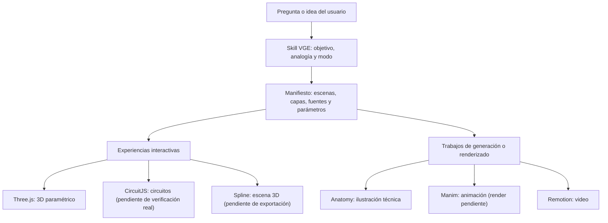

# VisualGraficEyes (VGE)

**Una iniciativa para que la inteligencia artificial no se limite a explicarlo todo con texto.**

VisualGraficEyes (VGE) es una metodología presentada como una *skill* que ayuda a elegir representaciones visuales apropiadas para explicar, aprender y prototipar: diagramas, ilustraciones de mecanismos, pasos animados, videos, modelos 3D, mapas y gráficos de datos. **No toda consulta necesita una imagen**; VGE busca usar el recurso más claro para cada tema, conservando las explicaciones necesarias y distinguiendo una ilustración de una simulación.

> **Estado del proyecto:** prototipo en desarrollo. El creador ha probado personalmente la skill, su aplicación mediante prompts y demostraciones de distintos modos. Estas experiencias no constituyen una validación universal con todos los asistentes de IA o dispositivos.

## Problema y propósito

Muchas respuestas de IA se presentan casi exclusivamente como texto, incluso cuando una representación visual permitiría entender mejor un proceso, una estructura o una idea. VGE nace para explorar formas de comunicación más claras, creativas e interactivas, especialmente para quienes aprenden visualmente o necesitan construir prototipos.

## ¿A quién va dirigido?

A estudiantes, docentes, desarrolladores, diseñadores y cualquier persona que quiera **comprender, enseñar o prototipar** con ayuda de la IA. Los contenidos deben ofrecer una explicación común accesible y dejar los detalles técnicos o avanzados para quien los necesite.

## Origen

VGE surgió de una inconformidad personal: recibir explicaciones de IA en largos bloques de texto, cuando podían presentarse de otras maneras. Su creador, que aprende mejor de forma visual, comenzó a experimentar con instrucciones, ejemplos y herramientas que permitieran **ver** lo que una respuesta intenta explicar, no solo leerlo.

## Tres maneras de explorar VGE

| Modalidad | Idea de uso | Alcance confirmado |
| --- | --- | --- |
| **Skill** | Consultar [`skill/SKILL.md`](skill/SKILL.md) y seguir sus instrucciones en un asistente que admita este tipo de integración. | El creador reporta pruebas personales con representaciones satisfactorias; compatibilidad e instalación dependen del entorno. |
| **Prompt** | Utilizar las pautas de VGE como instrucciones para pedir una representación concreta a una IA. | El creador reporta uso personal; no se garantiza que todos los modelos produzcan los mismos formatos. |
| **Demostraciones** | Explorar prototipos y escenas para entender posibilidades y límites. | El repositorio documenta una demo del motor de un ventilador; también se preparan ejemplos de siete modos para incorporar. Su publicación y funcionamiento en GitHub Pages están pendientes de verificación. |

## Herramientas: qué son, para qué se usan y qué está comprobado

VGE **coordina herramientas especializadas**, pero no las reemplaza ni convierte automáticamente los archivos de una en los de otra. La elección depende de la pregunta que se quiere explicar.

### Anatomy — Conocer las partes de un sistema

- **Qué es:** un kit de ilustración técnica para representar mecanismos, componentes y relaciones espaciales.
- **Para qué se incorporó:** enseñar cómo se organiza una máquina, reconocer piezas y explicar su función mediante una representación didáctica.
- **Ejemplo y evidencia:** el núcleo contiene una ilustración isométrica de rueda y eje; la documentación registra un HTML construido y revisado con el kit Anatomy.
- **Límite:** una ilustración de componentes no equivale por sí sola a una simulación mecánica exacta.

### CircuitJS/Falstad — Experimentar con circuitos

- **Qué es:** un simulador de circuitos eléctricos y electrónicos.
- **Para qué se incorporó:** complementar explicaciones con el comportamiento calculado de circuitos, en lugar de mostrar solo dibujos estáticos.
- **Ejemplo preparado:** fuente ideal de 5 V y resistencia de 1 kΩ, para la que la ley de Ohm predice 5 mA.
- **Límite:** existe un adaptador y un circuito preparado, pero **la importación y la medición en CircuitJS real no están verificadas**; falta configurar una distribución servida desde el mismo origen.

### Manim — Mostrar procedimientos animados

- **Qué es:** una biblioteca de Python para generar animaciones matemáticas y educativas.
- **Para qué se incorporó:** representar operaciones, secuencias y transformaciones paso a paso.
- **Ejemplo preparado:** tres grupos de dos fichas para ilustrar `3 × 2 = 6`.
- **Límite:** se comprobó la sintaxis del código Python, **no el video renderizado con Manim**; en la verificación documentada faltaba instalar el módulo.

### Remotion — Producir videos explicativos

- **Qué es:** una herramienta para crear y renderizar videos mediante React y código.
- **Para qué se incorporó:** convertir una explicación en escenas temporizadas, transiciones y un archivo de video compartible.
- **Ejemplo y evidencia:** se produjo e inspeccionó una composición de cinco segundos sobre una rueda y su eje, según la verificación del núcleo.
- **Límite:** fue una prueba de integración, no una lección audiovisual completa.

### Spline — Explorar escenas 3D

- **Qué es:** un entorno de diseño 3D con un formato de exportación que puede cargarse en la web.
- **Para qué se incorporó:** explorar objetos mediante perspectiva e interacción espacial, cuando el 3D realmente ayude a comprenderlos.
- **Estado:** el proyecto contiene un adaptador y el runtime de Spline; **falta una escena propia exportada como `.splinecode` y probar su carga e interacción real**. Una escena generada con Three.js no es una escena Spline.

### Three.js — El motor 3D paramétrico de VGE

- **Qué es:** una biblioteca de JavaScript para gráficos 3D en el navegador.
- **Para qué se utiliza:** representar la demostración del motor de un ventilador, con componentes, selección, capas explicativas y despiece didáctico controlados por el motor VGE.
- **Estado:** el repositorio documenta pruebas de su núcleo y una demo compilada. La representación es **ilustrativa**, no un cálculo electromecánico completo ni una prueba de rendimiento en móviles físicos.

## ¿Cómo se combinan?

La **skill VGE decide qué representación conviene**; un **manifiesto común** identifica las escenas, su motor, fuentes y capas de explicación; y los **adaptadores o tareas nativas** llaman a la herramienta correspondiente. Cada motor mantiene sus propios archivos y restricciones.



**Ejemplo conceptual, todavía no implementado de extremo a extremo:** para enseñar cómo funciona un motor eléctrico, VGE podría utilizar Anatomy para explicar las piezas, CircuitJS para experimentar con un circuito relacionado, Three.js o Spline para explorar el conjunto, Manim para desarrollar un concepto paso a paso y Remotion para producir un resumen en video.

**Lo que sí existe:** un manifiesto de ejemplo con distintas escenas y motores, validadores, adaptadores y algunas ejecuciones comprobadas individualmente. **Lo que aún no existe como resultado verificado:** una lección temática completa que integre todos los motores, convierta automáticamente sus formatos o comparta un único modelo físico sincronizado.

Para detalles de arquitectura, dependencias y evidencias, consulta [Núcleo y herramientas](docs/NUCLEO-HERRAMIENTAS.md) y [Verificación del núcleo](docs/NUCLEO-VERIFICACION.md). Esta última registra resultados de una entrega del **22 de octubre de 2026**; no debe leerse como una nueva ejecución de pruebas.

## Cómo comenzar

**Si quieres conocer el método:** lee [`skill/SKILL.md`](skill/SKILL.md). Sus indicaciones describen cómo seleccionar modos y verificar las herramientas disponibles. El procedimiento de instalación como skill depende del asistente que utilices.

**Si quieres explorar el prototipo actual:** sigue las instrucciones de **«Abrir y usar»** más abajo para `dist/index.html` (demo del ventilador). Requiere un navegador compatible con WebGL 2; el README existente documenta que esta demo se distribuye sin CDN.

**Si quieres contribuir al código:** sigue **«Desarrollar»** para conocer los requisitos de Node.js, comandos de prueba y arranque local. **Los siete modos** son un conjunto adicional de demostraciones que se planea incorporar al repositorio y publicar en GitHub Pages; todavía no se proporciona una URL verificada ni se promete que todo funcione sin conexión.

## Próximos pasos

1. Facilitar el uso de VGE como skill o prompt en diferentes entornos de IA.
2. Mejorar progresivamente las representaciones, interacciones y motores visuales.
3. Publicar una guía verificable de las demostraciones de siete modos y explorar su acceso por GitHub Pages y descarga local.
4. Mejorar la documentación para usuarios y futuras contribuciones.
5. Completar y comprobar las integraciones nativas pendientes (CircuitJS, Manim y Spline) y las pruebas entre motores.

Para proponer una mejora o reportar un error, puede utilizarse la sección **Issues** del repositorio. La guía formal `CONTRIBUTING.md` está prevista para el Laboratorio 6 y debe publicarse antes de anunciarla como disponible.

## Uso de inteligencia artificial

El proyecto se ha desarrollado con apoyo de herramientas de IA para explorar ideas, redactar instrucciones, generar código y producir ejemplos visuales. Las decisiones y el propósito de VGE fueron definidos por su creador. Algunas demostraciones fueron generadas a solicitud del creador con asistencia de IA. **El código, los recursos de terceros y las afirmaciones de funcionamiento requieren revisión humana antes de publicarse.**

---

## Documentación técnica existente

A continuación se conserva la documentación del núcleo y de la demo VGE 2.0. Las afirmaciones de pruebas corresponden a las entregas allí descritas; esta edición del README no supone una nueva ejecución.

### VGE · núcleo de herramientas nativas

El proyecto coordina **Anatomy, CircuitJS/Falstad, Manim, Remotion y Spline**, y
conserva Three.js para el abanico paramétrico. Cada motor mantiene sus fuentes
nativas. Hay un manifiesto común, adaptadores interactivos y tareas de build/render.

Empezar por [Núcleo y herramientas](docs/NUCLEO-HERRAMIENTAS.md) y
[Verificación actual](docs/NUCLEO-VERIFICACION.md).

```bash
npm ci
npm test
npm run core:validate
npm run core:doctor
npm run core:run -- maquina build
```

Anatomy y Remotion se ejecutaron nativamente; el motor PSC sigue pasando sus
pruebas. CircuitJS necesita su distribución local, Manim su instalación y Spline
una escena propia. Sus pruebas con dobles no demuestran ejecución nativa.
Las instrucciones para activar cada motor están en la documentación del núcleo.
La Fase 3 sigue pendiente de aprobación. La auditoría previa refleja la versión
anterior a esta ampliación.

La documentación y demo originales de Fase 2 se conservan a continuación.

### VGE 2.0 · Fase 2, público general por capas

Explicación del motor de un ventilador: pregunta → analogía de dos personas que empujan una rueda → escena 3D. La capa común permanece visible; los nombres técnicos, ondas y valores son opcionales. Las fórmulas y los límites se abren aparte. No se ha iniciado la Fase 3.

#### Abrir y usar

Abre `dist/index.html` en un navegador con WebGL 2. Contiene Three.js, validadores, geometría y datos: funciona sin conexión ni CDN. Recorre los cuatro pasos; al final puedes tocar piezas, girar la vista y abrir la ventana al interior o separar y volver a juntar el conjunto.

`Nivel` elige las capas que se abren por defecto en cada paso. `Ver el nombre técnico` y `Saber más` permiten abrirlas por separado. La capa común nunca desaparece. Las palabras se explican con ejemplos en el glosario tocable. El movimiento se puede pausar; con movimiento reducido comienza pausado.

El verde representa únicamente el campo. El azul identifica el rollo A y el naranja el B; las piezas físicas restantes son neutras. Las ondas, el brillo y la flecha leen el mismo reloj, y mover la línea blanca busca el mismo instante en todo el dibujo.

#### Archivos

| Archivo | Función |
| --- | --- |
| `examples/psc.lesson.json` | Historia en cuatro pasos, tres capas por paso, nombres comunes/técnicos, funciones, anclas y glosario |
| `examples/psc.beginner.json` | Modelo de la demo: 75 entidades, metal gris, corrientes ilustrativas y diez pasos disponibles por API |
| `examples/psc.beginner.graphics.json` | Plano, selección y campo con estela; dos etiquetas simultáneas en móvil |
| `examples/psc.json`, `psc.graphics.json` | Caso técnico previo para la API y regresiones; paleta física corregida |
| `examples/bubble-sort.json` | Segundo dominio usando el mismo contrato |
| `schema/vge.schema.json` | Contrato de dominio aprobado en Fase 1, conservado |
| `schema/vge.graphics.schema.json` | Configuración de efectos, ampliada con estela y visibilidad de componentes |
| `src/VGEEngine.mjs` | Jerarquía, poses, estado, validación, reloj y ciclo de vida |
| `src/graphics/FieldVectors.mjs` | Campo y estela a partir de los canales de corriente y sus fases |
| `src/graphics/CoilPulse.mjs` | Brillo de los rollos a partir de los mismos canales |
| `src/ui/mountBeginnerVGE.mjs` | Historia, capas, escena, selección y controles para el público general |
| `src/ui/SignalDiagram.mjs` | Ondas y cursor del reloj común |
| `tests/` | 50 pruebas de núcleo, gráficos y sincronización de la lección |
| `tools/check-390.cjs` | Comprobación puntual de navegador requerida para esta corrección |
| `docs/FASE-2.md` | Arquitectura, convenciones, rendimiento y rigor |
| `docs/CORRECCION-ADELANTO.md` | Corrección de B adelantada y nueva prueba de navegador a 390 px |
| `docs/REVISION.html` | Informe histórico de la revisión por capas anterior a esta corrección |

#### Desarrollar

Requiere Node.js 22 o posterior:

```sh
npm ci
npm test
npm run validate
npm run build
npm run dev
```

`dev` sirve la demo en `http://127.0.0.1:5173`; se puede cambiar con `VGE_PORT`. Las licencias de dependencias están dentro del HTML y en `dist/THIRD-PARTY-LICENSES.txt`.

La revisión de navegador es opcional para desarrollar y requiere Playwright:

```sh
npm install --no-save playwright@1.62.1
npx playwright install chromium
npm run check:390
```

`VGE_CHROME_PATH` permite usar un Chromium propio; `VGE_QA_DIR` cambia la salida de capturas. La comprobación de esta entrega utilizó Chromium 131 con WebGL por software. No es la matriz de Fase 5 ni mide FPS en un teléfono.

#### API conservada y extensión del reloj

`select(id)`, `explode(t)`, `setStep(n)`, `setParam(name,v)`, `injectFault(id)` y `dispose()` mantienen sus funciones. Los fallos siguen pudiendo cambiar parámetros y visibilidad; las escenas admiten predicción opcional. El JSON inválido muestra un panel con el motivo.

`getBindingState(id)` devuelve fase, velocidad angular de presentación, amplitud y desplazamiento de una animación. `seekCycle(id,fraction)` busca un instante de ese ciclo en todas las animaciones sin reconstruir geometría ni perder selección, despiece o parámetros. Las ondas muestrean ese mismo estado; no tienen otro reloj.

#### Límites

Es una **ILUSTRACIÓN**, no una solución del circuito ni una simulación electromecánica. La variante inicial elige amplitudes iguales y 90° para que el campo se vea circular; son supuestos ilustrativos. B empuja primero y A después: el capacitor adelanta la corriente de la rama auxiliar. La convención del dibujo usa i_A = sin(θ), i_B = a sin(θ + δ) y eje de B en −Z para que campo, pieza central y aspas giren hacia +X; el capacitor no es un temporizador. Su capacitancia no se usa para resolver aquí el desfase.

El brillo representa el valor absoluto de una señal relativa, no luminosidad ni calor reales. La velocidad de las piezas no se calcula desde el campo. En el control de turnos a 0° se detiene cualitativamente el giro del dibujo y se muestra un campo pulsante. Separar piezas es un recurso didáctico; no muestra un motor que funcione físicamente separado.

La Fase 3, el laboratorio de Hz y los fallos pedagógicos de Fase 4, y la matriz formal de Fase 5 siguen pendientes. WebXR, DOF, partículas y carga .glb permanecen fuera de alcance; .glb conserva solo su interfaz reservada.
