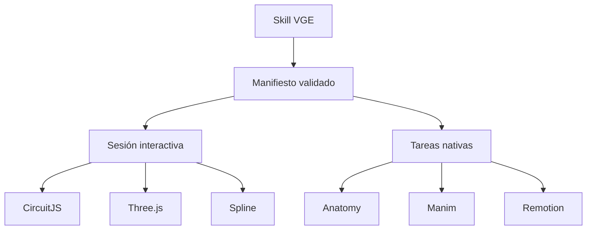

# VGE: núcleo de herramientas nativas

VGE organiza la explicación y delega en Anatomy, CircuitJS/Falstad, Manim,
Remotion y Spline. Conserva Three.js para el motor paramétrico del abanico.
Cada herramienta es un motor del proyecto; se carga la que requiere cada escena.
Esta entrega incorpora la orquestación, no desarrolla la Fase 3.

## Qué significa unificar

Un manifiesto agrupa fuentes nativas, etapas, parámetros y las tres capas de
explicación. VGE valida ese manifiesto, abre un motor interactivo o prepara y
ejecuta una tarea nativa. No convierte automáticamente entre Python, React,
SVG y `.splinecode`. Tampoco establece un reloj físico común entre motores.



`schema/vge.project.schema.json` valida el contenedor nuevo.
`schema/vge.schema.json` sigue validando los documentos del motor paramétrico.
No se añadieron propiedades incompatibles a los JSON anteriores.

## Contrato y archivos

| Archivo | Responsabilidad |
| --- | --- |
| `src/core/registry.mjs` | Identidad, modo, operaciones y skills de cada motor; no declara disponibilidad |
| `src/core/manifest.mjs` | Validación estructural y semántica; errores `VGE_INVALID_PROJECT` legibles |
| `src/core/VGESession.mjs` | Una escena interactiva activa; parámetros con rangos, capas y liberación |
| `src/core/adapters.mjs` | Puentes reales a las APIs Three.js, CircuitJS y Spline |
| `src/core/native-jobs.mjs` | Comandos nativos sin shell; datos comunes; comprobación de salida |
| `tools/vge.mjs` | Diagnóstico, validación, planificación y ejecución explícita |
| `examples/unified/project.json` | Seis escenas de prueba, una por motor; no es aún una única lección temática |
| `integrations/` | Fuentes y dependencias aisladas de Anatomy, Manim, Remotion y Spline |

Cada escena declara motor, fuente, habilitación, etiqueta ILUSTRACIÓN/SIMULACIÓN,
texto común, técnico y avanzado, y mapeos de parámetros cuando aplican.
`session.layers(1)` devuelve el texto común; niveles 2 y 3 conservan siempre ese
texto y añaden los detalles. El manifiesto inicial abre la capa 1.
El núcleo entrega esos datos; cada interfaz debe representarlos. Un MP4 no
tiene paneles tocables: sus detalles se conservan en el manifiesto compañero.

Los trabajos nativos reciben `{projectId, stageId, label, layers, parameters}`:
Anatomy como argumento JSON, Manim como `VGE_STAGE_DATA` y Remotion mediante
`--props`. Los ejemplos consumen la explicación común. Cada motor necesita su
propia relación entre parámetros y representación; no se inventa un vínculo
eléctrico con una ilustración que no lo calcula.

## Instalar y comprobar

Desde la raíz extraída del proyecto, con Node.js 22 o superior:

```bash
npm ci
npm test
npm run core:validate
npm run core:doctor
npm run example
npm run build
npm run dev
```

La demo anterior continúa siendo el abanico. Abrir `dist/index.html` permite
verla; el nuevo registro no añade todavía un selector gráfico de todos los motores.
El diagnóstico distingue dependencias presentes de fuentes configuradas.
Instalar paquetes no demuestra que una escena haya funcionado.

### Anatomy

```bash
npm run core:run -- maquina build
```

Abrir `out/anatomy.html`. Es una prueba de conexión del kit isométrico real,
con giro, pausa y capas de detalle; no pretende reemplazar la ilustración
completa del motor ni reproducir un reel concreto.
El kit y sus tres referencias disponibles proceden de la copia del trabajo
anterior. Se conserva su licencia MIT y su `SKILL.md`; esa copia es parcial:
no contiene todos los recursos mencionados por la skill original. No se
presenta como una instalación global completa de Anatomy.

### CircuitJS / Falstad

El adaptador llama `importCircuit`, `setSimRunning`, `setExtVoltage`,
`getTime` y `getElements` de CircuitJS1. El host debe servir una distribución
real del simulador **en el mismo origen** y esperar a `oncircuitjsloaded`.
Después pasa `iframe.contentWindow` como `circuitWindow` y un cargador de
texto como `readText`. La URL de configuración identifica el simulador esperado;
el adaptador no descarga ni construye su distribución por sí mismo.

`examples/unified/resistor.txt` es un circuito de contraste preparado: fuente
ideal de 5 V y resistencia de 1000 ohmios. El cálculo esperado es 0.005 A;
**la importación y medida en CircuitJS real son NO VERIFICADAS**.
No se incluye el simulador ni se ha validado su importación en esta entrega.
En el manifiesto está desactivado y sin URL. Habilitarlo solo después de
configurar el host. No sirve incrustar una página externa y asumir acceso a su API.
Para inyectar voltajes dinámicos hacen falta elementos de voltaje externo y
mapeos explícitos; el circuito mínimo preparado no los contiene.

Documentación: https://www.falstad.com/circuit/doc/js-interface.html

### Manim Community

Preparar un entorno Python separado e instalar las dependencias de sistema
indicadas por Manim para el sistema operativo. No se usa LaTeX en este ejemplo.

```bash
python3 -m venv .venv
.venv/bin/python -m pip install -r integrations/manim/requirements.txt
VGE_PYTHON=.venv/bin/python npm run core:run -- pasos render
```

Estos comandos de activación corresponden a Linux/macOS; en Windows usar el
Python de `.venv/Scripts/python.exe` y definir `VGE_PYTHON` en la shell local.
La fuente nativa `VGERows` representa tres grupos de dos fichas. Se comprobó
su sintaxis Python, **no su render**: Manim no está instalado en este entorno.
El intento real devuelve `No module named manim`, código 1, y VGE comunica el
error. La salida prevista es `out/manim.mp4`; su creación es NO VERIFICADA.

Documentación: https://docs.manim.community/en/stable/

### Remotion y sus skills

```bash
npm ci --prefix integrations/remotion
npm run core:plan -- video render
npm run core:run -- video preview
npm run core:run -- video render
```

La vista previa imprime su URL; el render crea `out/remotion.mp4`.
Las versiones de Remotion y sus paquetes se fijan juntas en 4.0.537.
El ejemplo es una composición nativa de conexión de cinco segundos sin audio.
Antes de crear o editar videos, VGE exige leer las skills oficiales pertinentes.
En esta entrega se leyeron `remotion-best-practices`, `remotion-create`,
`remotion-markup`, `remotion-render` y las reglas de composición y disposición
aplicables del repositorio oficial; no se instalaron como skills globales.
Revisión consultada: `039e8a2fc78b67efc228d5645367838b85818a1c`.
La regla queda guardada en la skill VGE para trabajos futuros.

Fuentes: https://www.remotion.dev/docs/ai/skills y
https://github.com/remotion-dev/skills . Revisar sus términos de licencia para
el uso y distribución previstos; esta entrega no les asigna licencia MIT.

### Spline

```bash
npm ci --prefix integrations/spline
```

El paquete aislado fija `@splinetool/runtime` 2.0.105.
`integrations/spline/mount.mjs` suministra su `Application` al adaptador.
Este carga `.splinecode`, ofrece variables, resuelve una pieza por ID y llama
`stop`, `play` y `dispose`. Resolver un ID no agrega automáticamente un contorno
de selección; las acciones visuales se deben autorizar y definir en la escena.

Falta una exportación de una escena propia. La escena está desactivada, con
`sceneUrl: null`; no se inventa una URL ni se presenta Three.js como Spline.
La instalación y sus firmas API se verificaron, pero la carga/interacción real
con un `.splinecode` es **NO VERIFICADA**. El runtime no crea el proyecto en
el editor. Cualquier edición automática en el servicio exige una conexión
real disponible; no se encontró un plugin útil en la búsqueda de esta entrega.

Documentación: https://docs.spline.design/exporting-your-scene/web/code-api-for-web

## Sesión interactiva del núcleo

```js
import {VGESession} from './src/core/index.mjs';
import {pscFactories} from './examples/psc-factories.mjs';

const session = new VGESession(manifest, {
  readJSON: async path => (await fetch(path)).json(),
  engineOptions: {geometryFactories: pscFactories},
  visibilityDocument: document,
  // Para pausa al salir de pantalla, pasar también surface e IntersectionObserver.
});
await session.open('abanico');
session.setParam('adelanto', 90);
session.command('explode', 0.5);
session.pause();
session.dispose();
```

Este ejemplo construye el motor. Para mostrarlo hay que inyectar renderer,
scene, surface y sus opciones, o usar las interfaces existentes.
El host controla los errores y su presentación. Una operación que un motor
no ofrece produce `VGE_UNSUPPORTED_OPERATION`; abrir un motor de video requiere
su tarea nativa. El contrato no promete despiece o mediciones en todos los motores.

La sesión pausa la actividad al ocultar el documento cuando se le pasa ese
documento. Con `surface` e `IntersectionObserver` también pausa fuera de pantalla.
La intención de pausa del usuario se conserva. Un host que no suministra esos
objetos debe gestionar la visibilidad por su cuenta.

## Verificación y límites

Ver `NUCLEO-VERIFICACION.md` para resultados de esta entrega.
Los tests con dobles de CircuitJS y Spline comprueban el puente, no prueban
los simuladores. Las fuentes nativas de Manim y las escenas externas se
mantienen como pendientes hasta una ejecución observada e inspeccionada.

Sigue pendiente un proyecto temático que combine los cinco motores, los
mapeos de sus modelos y sus pruebas de extremo a extremo. La UI unificada,
los breadcrumbs, voz y navegación de la Fase 3 siguen sin desarrollar.
La auditoría anterior describe el estado anterior a estos cambios.
